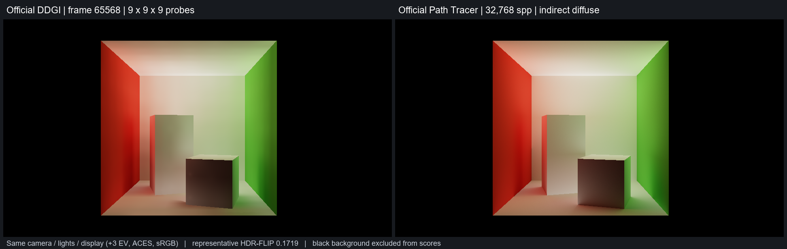
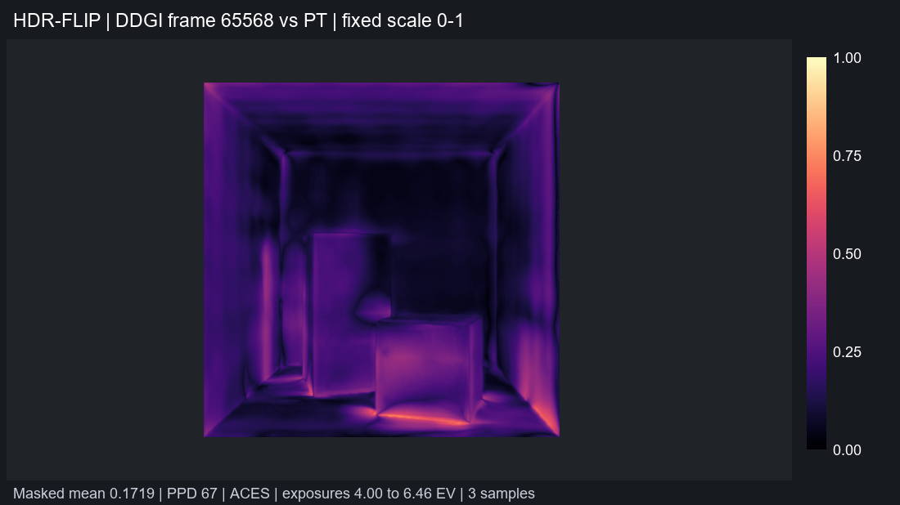

# NVIDIA Test Harness：DDGI 与 Path Tracer

本次在官方 RTXGI-DDGI 1.3.7 Test Harness 中，使用原始 Cornell Box、相同相机与顶部点光源，对比**仅间接漫反射**。采集和评分已完成。DDGI 保留了整体色溢与明暗关系，但柱子表面、墙角和接地处仍有明显局部差异；代表帧的有效区域平均线性亮度比 PT 低 **6.75%**。

这是长预热后的静态快照。DDGI 预热 65,536 帧后采集连续 32 帧；最后一次预热倍增中 HDR-FLIP 从 0.172905 降到 0.171897，仍有约 0.001 的缓慢变化，因此不把它描述为严格收敛。结果只覆盖本场景和本视角。

左侧为 DDGI 第 65,568 帧，右侧为官方 PT 的 32,768 spp 参考。两边均为 960×540，采用相同的 +3 EV、ACES 与 sRGB 显示转换。代表帧 HDR-FLIP 为 **0.171906**，未对 DDGI 额外做帧平均或调亮。观察前方矮柱的正面、柱脚，以及左侧高柱周围的光照过渡。

热力图越亮，局部感知差异越大；灰色区域不参与归约。图中柱脚、墙地交界与部分柱面误差较集中。这里的 FLIP 数值不是亮度百分比。

| 测量对象 | 有效帧 | Mean HDR-FLIP ↓ | 线性 RGB MSE ↓ | GI GPU ms |
|---|---:|---:|---:|---:|
| 官方 DDGI 对官方 PT | 32 | **0.171906** | **1.16727×10⁻⁵** | **0.2241** |
| 两组独立 PT 参考之间 | 1 对 | 0.012027 | 8.86048×10⁻⁸ | — |

第一行误差是逐帧评分后的平均。PT 参考之间的 FLIP 约为 DDGI 差异的 7%，残余噪声明显更小，足以支撑本次主要差异的判断。PT 使用两组不同随机序列，各 32,768 spp、最多 20 次表面迭代，保留官方的 albedo 上限及吞吐量终止条件。

GPU 计时来自 RTX 5080 / 驱动 617.14 上的 D3D12 时间戳，取同一 DDGI 运行中无图像读回的 2,021 个预热后样本。0.2241 ms 包含探针追踪、混合、relocation、classification 和屏幕 GI 查询，排除 GBuffer、合成、UI、呈现与读回。其主要分项为追踪 0.0717 ms、混合 0.0550 ms、屏幕查询 0.0798 ms。该数值是这个小场景、这个分辨率下的增量成本。

配置为 9×9×9 探针、间距 0.3、每探针 256 条射线、history 0.97，relocation/classification 开启，随机种子固定为 12345。顶部点光源位于 (0, 1.9, 0)，power=1、radius=4；方向光、聚光灯及环境光为零。相机位于 (0.1, 1, 4)，FOV 45°；两条路径均采用像素中心采样，关闭 AA 和额外 AO。

指标使用 NVIDIA `flip-evaluator 1.7` 的 HDR 模式，PPD=67、ACES、曝光范围 4.00188–6.46117 EV，共 3 个曝光。范围由 PT 可见场景区域一次确定，再固定用于全部帧。计算完整画面的误差后，在固定几何 mask 内归约，共 188,790 个像素；保留暗部，只排除场景外背景。MSE 使用曝光前的原始线性 RGB。

为取得可比信号，测试副本增加了浮点纹理导出、定长采集，以及 PT 排除首个命中点直接光的测量输出。**DDGI SDK 与 DDGI 着色器没有改动**；已核对 47 个 SDK/官方着色器文件与原始发布包一致。原来的示例源码与启动程序已恢复，测试补丁独立保存。官方 DDGI 的 GBuffer albedo 编解码与 PT 直接使用命中材质的差异也被保留，所以这是官方示例两条完整路径的差异，不能全部归因于探针插值，也不能据此判定 Falcor 的接入正确与否。

复现入口见 [reproduction/README.md](reproduction/README.md)。完整配置在 [manifest.json](manifest.json)，逐帧数据在 [metrics.csv](metrics.csv)，汇总在 [summary.json](summary.json)，计时样本在 [timing.csv](timing.csv)。原始线性图像保存在 `reference/`、`frames/`，代表帧误差保存在 `errors/flip-representative.exr`。
