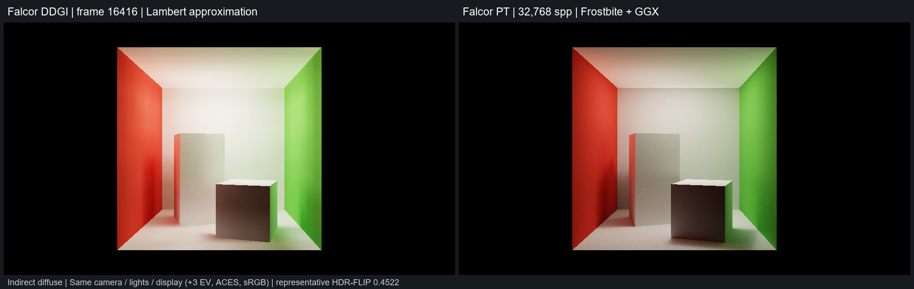
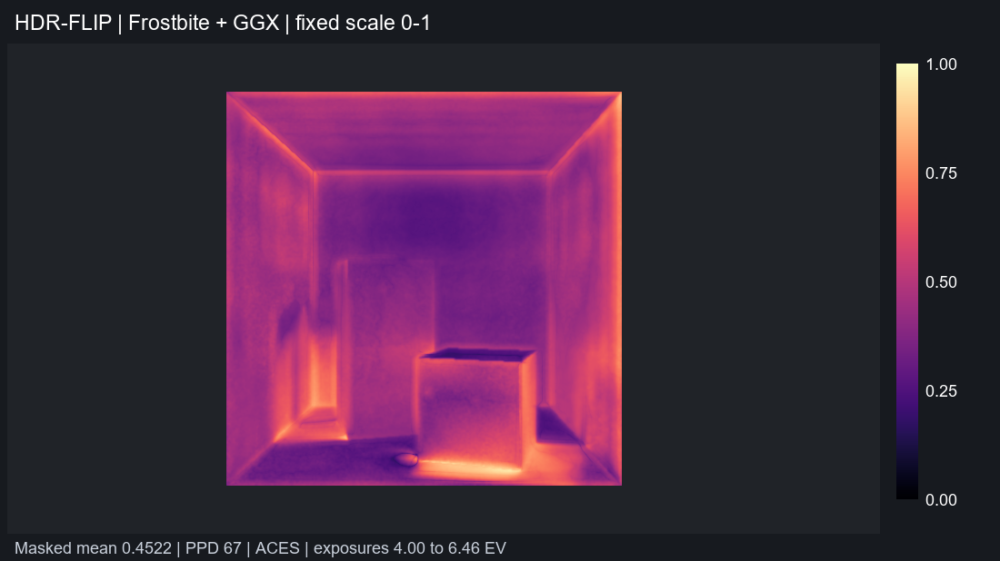

# Falcor DDGI vs PT：当前 StandardMaterial

已完成 32 帧静态评估。Mean HDR-FLIP **0.4523**；线性 RGB MSE **0.00128046**；DDGI GPU **0.231 ms**。

左 DDGI，右 PT；同相机、同灯光、同显示变换。代表帧 16416 的 HDR-FLIP 为 0.4522。

| 有效帧 | Mean HDR-FLIP | 线性 RGB MSE | GI GPU ms |
|---:|---:|---:|---:|
|32|0.452255|0.00128045635|0.230605|

PT 32,768 spp，另跑独立序列，参考间 HDR-FLIP 0.032753。DDGI 预热 16,384 帧；GPU 取独立 511 个完整时间戳区间，包含更新和查询。有限采样与有限反弹参考；静态单场景结果。材质模型和与官方示例的区别见[总报告](../report.md)。

[配置 manifest](manifest.json) · [逐帧指标](metrics.csv) · [GPU 计时](timing.csv) · [汇总](summary.json) · [PT EXR](reference/pt.exr) · [复现](../reproduction/README.md)
