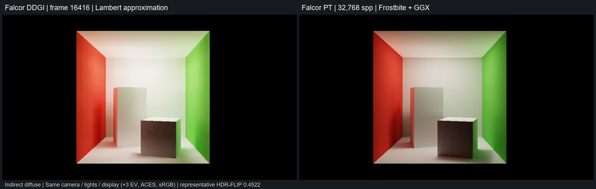
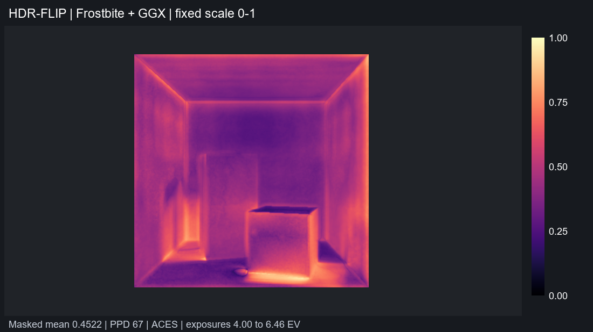
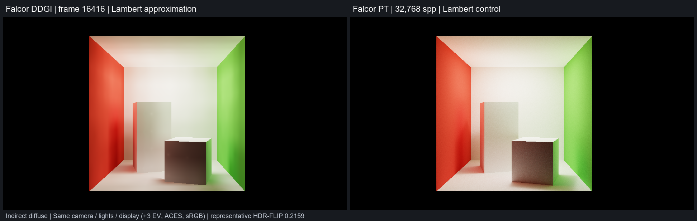

# Falcor DDGI 与 Path Tracer 对比

已完成。**当前 Falcor 的差异比官方示例大；将材质对齐为纯 Lambert 后，误差接近官方的量级，但还没有一致。** 当前材质下，DDGI 的有效区域平均线性亮度比 PT 高 98.4%；纯 Lambert 对照下则低 14.4%。测试没有修改产品 DDGI。

| 对比 | Mean HDR-FLIP ↓ | 线性 RGB MSE ↓ | GI GPU ms | DDGI 平均亮度相对 PT |
|---|---:|---:|---:|---:|
| 官方 Test Harness（此前结果） | 0.1719 | 1.16727e-05 | 0.224 | -6.7% |
| Falcor 当前材质 | 0.4523 | 0.00128046 | 0.231 | +98.4% |
| Falcor 纯 Lambert 材质对照 | 0.2162 | 0.000153541 | 0.226 | -14.4% |

两组 Falcor 都逐帧评估 32 帧后取平均，没有额外平均 DDGI 图像。官方使用此前已完成的结果。三组使用同一几何、相机、mask、HDR-FLIP 参数和显示曝光；灯光衰减、材质、部分探针参数与预热预算仍有引擎差异，因此表格用于描述差异，不作为接入合格判据。MSE 保留各自原始辐射度尺度。

当前材质：左 DDGI，右 Falcor PT。两边显示首个表面的间接漫反射，统一 +3 EV、ACES、sRGB。代表帧 16416，HDR-FLIP 0.4522。DDGI 的墙面、柱体和地面普遍偏亮，接触区也更平滑。

同一帧的 HDR-FLIP 热力图，固定 0–1 色标。误差遍布表面，不仅集中在轮廓。

材质控制实验保持颜色、几何、相机、灯光和 DDGI 参数不变，仅在独立测试场景中把三个 StandardMaterial 换成 PBRTDiffuseMaterial（纯 Lambert）。**32 帧 DDGI 与原材质逐像素完全相同**，PT 参考改变，HDR-FLIP 从 0.4523 降到 0.2162。这确认材质路径不一致是本次偏差的主要来源之一。

原因在于 DDGI 更新和屏幕查询都按 `albedo / π` 计算；当前 StandardMaterial 实际编译的是 **Frostbite 漫反射 + GGX 镜面**。`BSDFConfig.slangh` 的默认宏覆盖了材质文件中 Disney 的概括性注释。粗糙度为 1 时，Frostbite 漫反射含 `energyFactor = 1 / 1.51`，另有随方向变化的散射因子；多次反弹会累积差异。纯 Lambert 控制同时去除了镜面分支，本次没有把两者的影响进一步单独分解。

Lambert 对照的 HDR-FLIP 比官方高 0.0443。剩余差异不能直接归因于 DDGI 接入：Falcor 点光源使用近似 `1/r²` 衰减，官方用 `1/max(r,1)²`，并乘半径 4 的窗口函数；靠近顶灯的表面受光强度不同。两边还有 probe 格式、relocation 最小距离（Falcor 0.03、官方 0.1）、历史亮度阈值和官方 GBuffer 色彩往返转换等差别。本次保留这些原有行为。

每组 PT 为 **32,768 spp、最多 20 个表面顶点、关闭 RR、无降噪**，另跑不同随机序列。当前材质的 PT–PT HDR-FLIP 为 0.0328，Lambert 为 0.0241，分别约为 DDGI 差异的 7.2%、11.1%。参考仍有残余噪声，但不足以解释当前材质的大幅偏亮。另以相同种子检查 PT Default 与 MinimalPayload 后端，4,096 spp 的漫反射与完整间接光输出均逐像素一致。

DDGI：9×9×9 probes、每探针 256 rays、间距 0.3，最多 186,624 条 probe rays/更新；relocation 和 classification 开启。先更新 16,384 帧，再采集 32 帧。8,192 与 16,384 帧的 HDR-FLIP 变化约 0.002，按长预热后的固定预算结果报告。GPU 使用 RTX 5080 / 617.14；计时取 Falcor GPU profiler 的完整 DDGI pass，包含 probe 更新和屏幕查询，排除 GBuffer、PT、读回与文件输出，另取 511 个完整时间戳区间。未测试动态闪烁。

原始数据与复现：[当前配置](native/report.md)、[Lambert 对照](lambert-control/report.md)、[复现说明](reproduction/README.md)、[汇总 JSON](summary.json)。每个用例目录包含 32 份候选 EXR、两份独立 PT EXR、误差 EXR、mask、逐帧 CSV、计时 CSV 和 manifest。官方基线见 [此前报告](../2026-11-16_12-04_NVIDIA-DDGI-vs-PT_CornellBox/report.md)。
