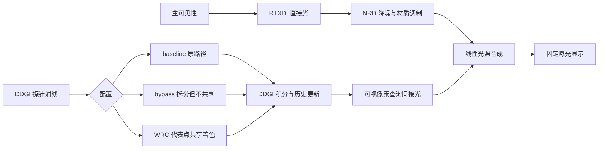
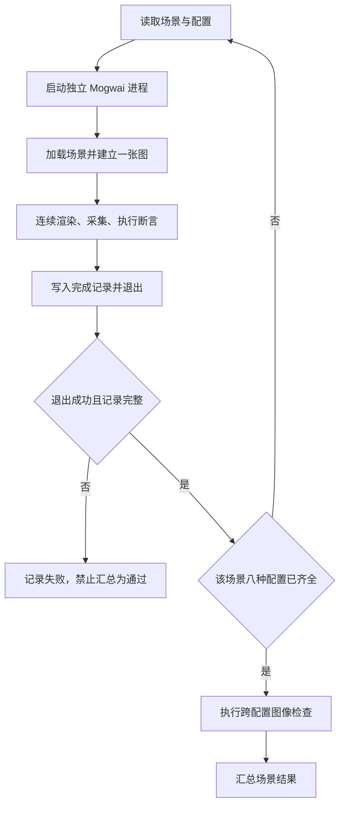

# IdTech8 启发的 WRC + DDGI 测试方案

更新日期：2026-10-26。测试对象是本地 Falcor 中的 DDGI 与 World Radiance Cache（WRC）改造。本文面向需要复现测试、解释图像差异和评估优化收益的开发者。

本文件记录三部分内容：已经实现的自动化回归、已经执行的收敛与单帧对比补测，以及尚待实现的正式判稳流程和扩展测试。目录名用于归档相关研究；当前结果验证的是本地适配实现，不能代表 idTech 8 引擎本身的质量或性能。

## 1. 要回答的问题与当前状态

测试必须分别回答以下问题，报告中不把它们合并成一个笼统的“通过”。

| 问题 | 对应证据 | 当前状态 |
| --- | --- | --- |
| 拆分着色流程是否保留原 DDGI 结果？ | baseline 与 bypass 的同更新次数、逐像素 HDR 对比 | 两个场景的间接光均通过现有严格容差 |
| 开启共享后改变了多少光照？ | WRC 与 baseline 的间接光误差、均值和局部差异 | 固定预热回归已有结果；不代表所有配置已收敛 |
| 光照是否进入可用于稳定截图的状态？ | 同一个配置在不同时间段的图像变化 | Cornell 通过补充长窗口检查；Room 尚未通过 |
| 缓存发生冲突或失效时是否正确？ | 射线计数、回退、光源变化、bias、相机和开关测试 | 当前用例通过 |
| 减少着色计算是否带来实际加速？ | 同预算下的 GPU 分阶段计时 | 已有短时计时；收益依场景而变 |
| 正常实时运行是否长期稳定？ | 固定渲染图连续运行及资源趋势记录 | 尚未完成专门的长期验证 |
| 连续重建图、反复编译是否稳定？ | 独立的重建压力测试和崩溃转储 | 存在未根治的崩溃，默认回归采用进程隔离 |

**两个配置互相一致，与它们各自是否已经收敛，是两个独立判断。** 两种路径可能产生几乎相同的结果，同时仍有相同的时间波动。

本文采用以下状态词：

- **已实现**：当前脚本中有对应逻辑。
- **已执行**：存在完整运行产物，可追溯到具体目录。
- **诊断结果**：用于解释问题，不等同于正式验收。
- **计划项**：本文规定的后续工作，尚不能计入通过数量。

## 2. 测试对象和光照管线

### 2.1 各系统的职责

| 部分 | 当前提供方 | 本方案如何观察 |
| --- | --- | --- |
| 可视像素的直接光采样 | RTXDI，时空重采样 | 单独保存直接光输出 |
| 直接光降噪 | NRD，RelaxDiffuseSpecular | 保持配置一致，避免与间接光差异混淆 |
| 漫反射间接光 | RTXGI-DDGI 探针场 | 保存 DDGI 间接光 HDR，作为主要比较对象 |
| 探针射线命中点的共享着色 | 本地 WRC 实验实现 | 对照关闭、拆分但不共享、开启共享等配置 |
| 探针积分、历史混合、可见性及重定位等 | DDGI SDK 与本地接入逻辑 | 检查计数、输出和生命周期行为 |
| 最终显示 | 直接光与间接光合成，再经过 ToneMapper | 保存线性合成 HDR 和显示 PNG |

屏幕直接光使用 RTXDI，不意味着每条 DDGI 探针射线的命中点着色也由 RTXDI 求解。WRC 改造主要作用于探针更新阶段的命中点着色；该阶段仍需要自身的直接光估计和历史 irradiance 查询。



### 2.2 baseline、bypass 与 WRC 的含义

- **baseline**：关闭 WRC，使用原有 DDGI 探针射线着色路径。它是本次改造的回归参考，不是路径追踪真值。
- **bypass**：执行拆分后的流程，但禁用缓存共享，每条有效射线仍做原有着色计算。它用于判断拆分、数据传递和不同执行阶段是否引入额外误差。
- **WRC**：允许多个命中点共享代表点的着色结果。这会改变空间近似和采样相关性，应测量误差，而不是要求与 baseline 逐位相同。

本轮没有以收敛 PathTracer 图像作为真值。因此，报告中的“相对误差”表示相对原 DDGI 的差异，不能直接解释为相对物理真值的误差。

## 3. 环境与控制变量

### 3.1 当前固定设置

| 项目 | 当前设置 |
| --- | --- |
| 渲染器 | Mogwai，D3D12，Release，headless |
| 常规分辨率 | 320 × 240 |
| 尺寸切换用例 | 401 × 301，随后恢复 320 × 240 |
| 探针网格 | 8 × 6 × 8，共 384 个探针 |
| 每探针射线数 | 256；名义总量为 98,304 条，实际有效着色射线由统计给出 |
| DDGI 历史权重上限 | hysteresis = 0.97 |
| 查询偏移 | normalBias = 0.05，viewBias = 0.05 |
| 探针重定位、分类 | 开启 |
| 包围盒 | autoBounds = True |
| 探针持续更新 | 开启；仅冻结测试会暂时关闭 |
| 直接光 | RTXDI SpatiotemporalResampling，RayTraced bias correction |
| 降噪 | NRD RelaxDiffuseSpecular，开启 |
| 显示曝光 | 自动曝光关闭，exposureCompensation = 0 |
| 主可见性采样 | Center，关闭景深，开启 alpha test |

### 3.2 两配置必须保持一致的条件

比较时固定场景文件、材质和灯光初始状态、相机、分辨率、探针布局、射线预算、DDGI 参数、RTXDI/NRD 参数及显示映射。每组从新进程、新渲染图和重新加载的场景开始；脚本暂停场景时钟并关闭相机动画。

暂停场景时钟不会停止探针更新和各 pass 的采样序列。用于对齐图像的是 `p.updatedFrames` 等记录，而不是截图文件末尾的 `.0`：在暂停时钟的情况下，文件名中的时钟帧编号可能一直为 0。

当前做法统一了初始采样状态和更新预算，不保证 GPU 并行过程在所有路径上逐位确定。尤其是共享代表点由并行插入产生时，应保留重复运行的结果分布。

### 3.3 环境记录

常规回归的工作进程 `run.json` 已记录：命令、选中的场景和配置、相关环境变量、Python/Windows 版本、Git HEAD、所列源文件的状态与 SHA-256，以及 Mogwai、Falcor、Slang、RTXGIDDGI 插件的二进制哈希。

Git HEAD 不能单独标识带有未提交修改的构建。读取结果时需要同时检查源文件与二进制身份。当前清单也不是对全部依赖的完整归档。

正式性能报告还应补记 GPU 型号、驱动版本、完整构建配置、运行时依赖版本、初始相机参数、场景资源身份、后台 GPU 负载和 shader cache 冷暖状态。这些字段目前没有全部自动采集。

## 4. 进程隔离与执行顺序

默认顺序是：**启动一组配置 → 完成采集和统计 → 进程完全退出 → 启动下一组配置。** 渲染测试串行执行，不同时跑多个测量进程。



正常实时渲染在图和 shader 建立后持续执行已有程序，不需要每帧重建图。为每组测试重建图，是为了隔离历史状态和初始采样序列。

常规运行器以同步子进程调用等待退出。成功条件包括退出码为 0、没有 `failure.txt`、存在完成记录，且日志没有 `(Error)`。工作进程成功只表示该组采集及组内检查完成；八组都齐全并通过跨配置检查后，场景才报告通过。

保留两种非默认诊断模式：

| 模式 | 进程组织 | 用途 |
| --- | --- | --- |
| 默认 | 每场景、每配置一个进程，共 16 个 | 日常功能和图像回归 |
| `--per-scene` | 每场景一个进程，内部连续重建 8 张图 | 场景内重建诊断 |
| `--single-process` | 两个场景、16 组配置共用一个进程 | 连续重建和编译压力测试 |

进程隔离已经避开本轮默认回归中的连续重建崩溃，但没有修复原始 Slang 崩溃。正常固定图长时间运行与重建压力测试，需要分别记录结果。

## 5. 常规回归矩阵：2 个场景 × 8 种配置

### 5.1 场景

| 标识 | 资产 | 当前用途 |
| --- | --- | --- |
| `cornell` | Cornell Box | 比较色彩传播、遮挡、共享近似，以及发光材质变化后的响应 |
| `room` | grey_and_white_room | 比较室内复杂遮挡、环境光响应、相机距离 LOD 和时间波动 |

两个场景均使用其默认相机及本轮脚本指定的初始设置。它们只是当前回归样本，尚不能覆盖所有材质、几何和光源情况。

### 5.2 公共 WRC 参数

| 参数 | 值 | 含义 |
| --- | ---:| --- |
| `wrcCellScale` | 0.1 | 基础单元宽度相对最小探针间距的比例 |
| `wrcTableSize` | 65536 | 哈希槽数量 |
| `wrcLodDistance` | 8.0 | 距离分级尺度，以最小探针间距为单位 |
| `wrcMaxLod` | 16 | 单元宽度最大倍数；1 表示固定基础尺寸 |
| `wrcProbeLimit` | 16 | 一次哈希查询最多探测的槽数量，不是 DDGI 探针数量 |
| `wrcMaxAge` | 0 | 默认不跨更新复用着色结果 |
| `wrcShadeSamples` | 1 | 每个代表点的直接光采样次数 |

### 5.3 八种配置

下表仅列相对公共参数的变化。

| 配置 | 参数变化 | 主要检查 |
| --- | --- | --- |
| `baseline` | `useWRC=False` | 原 DDGI 参考 |
| `bypass` | `useWRC=True`，`wrcBypassSharing=True` | 拆分但不共享是否保留结果；所有有效射线回退，缓存占用为 0 |
| `wrc` | `useWRC=True` | 默认空间共享、距离 LOD 的误差与成本；确认实际使用了大于 1 的 LOD |
| `lod1` | 开启 WRC，`wrcMaxLod=1` | 固定单元尺寸，隔离距离 LOD 的影响 |
| `probe1` | 开启 WRC，`wrcMaxLod=1`，`wrcProbeLimit=1` | 与 lod1 对照，测量单槽探测造成的回退 |
| `collision` | 开启 WRC，`wrcTableSize=64` | 制造哈希拥挤，确认探测预算耗尽和回退路径被执行 |
| `lodCoarse` | 开启 WRC，`wrcLodDistance=2.0` | 更早使用大单元，观察节省计算与误差的关系 |
| `temporal` | 开启 WRC，`wrcMaxAge=2` | 检查有限跨帧复用，并继续执行全部生命周期用例 |

因此，16 组是两场景各跑八种参数配置，不是 16 种独立 GI 算法。

## 6. 常规采集时序和 336 张 HDR 的来源

### 6.1 每组的固定预热回归

1. 新建图、加载场景，并设置该组参数。
2. 完成第 1 次 DDGI 更新，保存 `first` 图像和统计。
3. 再更新 127 次，到第 128 次更新。
4. 在第 128、129、130、131 次更新各保存一组图像与统计。
5. 开启 profiler 后先运行 8 帧，再记录 64 帧 GPU 时间。
6. 非 temporal 配置结束并退出；temporal 配置继续执行生命周期测试。

这些文件沿用 `steady-0`～`steady-3` 的历史命名，但当前主脚本没有自动判稳。本文将它们称为“固定预热帧”，不得仅凭文件名将它们解释为已经收敛。

### 6.2 每次采集的三个 HDR 通道

| 输出 | 含义 | 数值比较用途 |
| --- | --- | --- |
| `DDGI.indirect` | DDGI 漫反射间接光 | baseline/bypass 严格对比及 WRC 主要质量指标 |
| `DirectModulate.output` | 当前管线的直接光合成项，含其保留的自发光等项 | 将直接光路径变化与 WRC 影响分开观察 |
| `DDGI.color` | 同帧最终线性光照合成 | 检查合成关系及完整画面差异 |

同时输出的显示 PNG 用于观察，不计入 336 张 HDR，也不用于线性误差计算。EXR 比较读取 RGB；不把 alpha 混入光照误差。

### 6.3 数量明细

每场景八种配置各采集 5 次，共 40 个采集时刻。temporal 组再增加以下 16 个时刻：

| 附加测试 | 截图时刻 | 次数 |
| --- | --- | ---:|
| 灯光变化 | 改变前、变暗首帧、变暗更新后、恢复更新后 | 4 |
| 相机往返 | 移动前、移远首帧、移远更新后、返回首帧、返回更新后 | 5 |
| WRC 开关 | 关闭首帧、重新开启首帧、开启更新后 | 3 |
| 冻结 | 冻结后、再运行 8 帧后 | 2 |
| 尺寸变化 | 401 × 301、恢复 320 × 240 | 2 |
| 合计 |  | 16 |

总量为：

```text
每场景： (8 × 5 + 16) × 3 = 168 张 EXR
两场景： 2 × 168 = 336 张 EXR
```

这是 112 个采集时刻对应的三个输出通道。实际渲染的帧数更多；收敛补测还另有监控截图，不计入这 336 张。

## 7. 图像比较方法

### 7.1 输入要求

两图必须具有相同分辨率、相机和通道含义。比较原始线性 HDR，不先做曝光匹配、逐图归一化、色调映射或裁剪亮部。

读取时检查全部 RGB 值有限，不允许 NaN 或 Infinity。当前检查器还要求 RGB 最小值不低于 -1e-5，并检查合成及直接光输出不是全黑。参考间接光的均值和能量过低时，不报告无意义的相对误差。

以下用 A 表示参考图，B 表示被测图，i 遍历全部像素的 RGB 分量，N 为分量数量。320 × 240 图像的 N = 230,400。

### 7.2 最大绝对误差、平均误差与相对 RMSE

```text
每个分量的绝对误差： e_i = |B_i - A_i|
最大绝对误差：       E_max = max(e_i)
平均绝对误差：       MAE = Σ e_i / N
均方根误差：         RMSE = sqrt(Σ (B_i - A_i)^2 / N)
相对均方根误差：     rRMSE = sqrt(Σ (B_i - A_i)^2 / Σ A_i^2)
RGB 总体均值：       μ(A) = Σ A_i / N
间接光均值比：       μ(B) / μ(A)
```

E_max、MAE 和 RMSE 的单位是线性光照值，不是百分比，也不是 0～255 色值。rRMSE 是无量纲比值；显示为百分比时乘以 100。这里的 μ 是 RGB 分量平均值，不是采用人眼权重计算的亮度 Y。

E_max 说明最坏的单个像素通道差异，不能单独概括整张图。因此正式结果同时给出 MAE、RMSE、rRMSE、均值比，以及异常区域的图像。

### 7.3 baseline 与 bypass 的当前严格检查

逐一对比 `first` 和四张固定预热帧，共五对间接光图；每个分量必须满足：

```text
|A_i - B_i| <= 2e-6 + 2e-5 × max(|A_i|, |B_i|)
```

报告的 `violating_components` 是超限通道值的数量，不是超限像素数量。通过要求为 0。

之前对话中的“最大绝对误差”来自这五对图各自 E_max 的最大值，包含首帧。它既不是只取最终一对图，也不是先平均五帧再比较。

脚本还比较最后一张固定预热帧中的探针总数、活跃数、重定位数和更新次数。上述严格一致性结论主要约束间接光；不能用它代替最终合成画面的误差。

### 7.4 WRC 相对 baseline 的当前质量检查

当前主检查器分别将第 128～131 次更新的四张间接光图做逐像素平均，再比较两个平均图。这有助于降低单帧波动，但不会证明它们已经收敛。

现有自动门限如下：

| 配置 | 当前处理 |
| --- | --- |
| wrc、lod1、probe1、collision、temporal | rRMSE ≤ 0.4，且均值比在 [0.7, 1.3] |
| lodCoarse | 报告误差，作为更粗共享的取舍实验，不应用上述质量门限 |
| bypass | 另外执行第 7.3 节的逐帧严格比较 |

0.4 对应 40% 相对 RMSE，是现有的明显回归检查门限，不代表“视觉上几乎没有误差”。若要制定更严格的画质目标，应在运行前确定门限和场景，再单独报告结果。

### 7.5 同帧合成与冻结检查

全部采集时刻都检查：

```text
DDGI.color ≈ DirectModulate.output + DDGI.indirect
```

当前合成容差为绝对 2e-5 加相对 2e-6，与 bypass 的严格容差不是同一组常数。

冻结期间的间接光、以及恢复原尺寸后的间接光，与冻结参考图比较时只允许 1e-6 的绝对误差。冻结测试仅要求间接光保持相应行为；直接光和最终显示可能仍随帧更新。

## 8. “稳定后各截一张”的完整流程

### 8.1 判稳与配置对比使用不同的数据

判稳回答“同一个配置随时间是否仍明显变化”，需要多个时刻的数据；配置对比回答“两个配置在相同条件下差多少”，最终可以只使用一对单帧图。

本方案保留两个独立标记：

- `stable`：是否满足指定的时间稳定条件。
- `equivalent`：两配置对应图像是否满足指定的一致性容差。

渲染进程正常退出也不能自动把这两个标记设为真。当前补测脚本即使没有判稳，也会保存最终图并正常退出；必须读取完成记录中的状态。

### 8.2 已执行的短窗口判稳诊断

每隔 128 次 DDGI 更新，采集该位置最后 8 次连续更新的间接光图，计算平均图。首个窗口终点为 768，初次运行的预算上限为 4096。

相邻两个窗口计算：

```text
空间变化： rRMSE(前一窗口平均图, 当前窗口平均图)
均值变化： |μ(当前窗口) - μ(前一窗口)| / |μ(前一窗口)|
```

要求空间变化 ≤1%、均值变化 ≤0.2%，并连续三个间隔满足条件。达到预算上限仍未满足时，标记未判稳，保留全部监控数据。

此次 Cornell、Room 的 baseline 与 bypass 均未通过这项短窗口条件。随机采样和历史滤波会让短窗口仍有变化，因此不能仅从失败推断存在代码错误，也不能把失败静默改成通过。

### 8.3 已执行的长窗口补充检查

短窗口失败后，本次诊断增加了长窗口分析。取最后 20 个监控窗口，前 10 个和后 10 个分别平均，比较两个时段的平均图。

每个监控窗口有 8 张图，因此每个长时段使用 80 张图。**这 80 张图来自间隔采样的十个窗口，并不是连续 80 帧。** 长窗口沿用空间变化 ≤1%、均值变化 ≤0.2% 的门限，但它是另一项检查，不能替换短窗口失败的记录。

| 场景与最终更新次数 | 前时段采样范围 | 后时段采样范围 | 每时段实际样本数 |
| --- | --- | --- | ---:|
| Cornell，4096 | 1657～2816 中的十个 8 帧窗口 | 2937～4096 中的十个 8 帧窗口 | 80 |
| Room，16384 | 13945～15104 中的十个 8 帧窗口 | 15225～16384 中的十个 8 帧窗口 | 80 |

长窗口是观察短窗口失败后增加的诊断，不是事前冻结的正式验收流程。下一版正式收敛测试应在运行前确定窗口、门限、预算及失败处理，避免事后挑选有利时段。

有限时间窗口只能支持“在该观测尺度下变化较小”的结论，不能证明数学意义上的完全收敛。持续波动也可能来自稳态随机噪声，需要额外的方差分析区分。

### 8.4 正式单帧 A/B 流程：目标方案，尚未全部自动化

1. 预先固定场景、参数、判稳算法、预算和图像误差门限。
2. baseline、bypass 分别在新进程中运行，记录各自判稳状态及更新次数。
3. 如果任一配置未判稳，报告“预算内未判稳”，保留诊断图，不把该组命名为稳定画面对比。
4. 两配置均判稳后，选择共同更新次数 T，至少覆盖两者所需预热预算。
5. 从相同初始状态分别运行到 T，并再次确认 T 前的监控窗口满足条件。只选择较大的 T，并不能自动保证较早判稳的配置之后仍稳定。
6. 在相同 T 各保存一张原始间接光 EXR、直接光 EXR、合成 EXR，以及使用相同曝光的显示 PNG。
7. 最终配置误差使用这两张单帧 EXR，不用判稳平均图替换单帧结果。
8. 分别报告间接光、直接光和合成图的误差。必要时增加固定倍率的差异图，并注明倍率与色标。
9. 重复运行以观察并行随机性；运行次数、种子和结果范围均写入报告。

当前补测的两配置恰好都运行到同一个预算上限，分析脚本会断言更新次数一致；它尚未实现任意配置的自动共同 T 协商与重跑。

截取最终图时仍保持探针更新开启。不要通过冻结更新让画面不再变化，再把“被固定住”当成自然判稳。

## 9. 缓存计数与算法行为检查

### 9.1 射线、缓存条目与回退守恒

当前采样统计执行以下断言：

```text
servedRays + fallbackRays = validRays
shadedEntries + temporalReusedEntries = occupiedEntries
servedRays >= occupiedEntries
occupiedEntries <= validRays
activeEntries = occupiedEntries
probeLimitFailures <= fallbackRays
probeSteps <= validRays × wrcProbeLimit
```

同时要求 `finite=True`、`usingRTXDI=True`、全部 `rejected*` 计数为 0，以及 `wrcNonFiniteResults=0`。这些是明确采样时刻的检查，不应描述为已经逐帧读取了全程所有 GPU 状态。

### 9.2 材质分组与间接调度

当占用条目不为空时，检查非空材质组数为正且不超过条目数；调度线程数是 64 的倍数，并满足：

```text
occupiedEntries <= scheduledThreads < occupiedEntries + 64 × nonemptyGroups
```

空表时，调度线程数和非空组数均须为 0。这能检查活动列表与组内补齐计数，但不能单凭计数证明每个材质的着色语义都正确。

### 9.3 LOD、哈希冲突和共享范围

- 默认 WRC 场景必须实际出现大于 1 的 LOD；否则没有覆盖到距离分级路径。
- lod1、probe1 的最大 LOD 必须保持为 1，粗 LOD 射线计数必须为 0。
- 实际 LOD 倍数应属于支持的二次幂集合，且不超过配置上限。
- collision 配置必须出现回退和探测预算失败，确认压力路径被触发。
- lod1 与 probe1 使用相同表容量，对照检查 16 次探测确实比 1 次探测减少回退。
- 跨三角共享计数不得超过 servedRays；其绝对数量依赖场景材质划分，不要求每个场景都必须发生同样程度的跨三角共享。

当前测试不等同于对所有完整键边界、法线量化边界和并发竞争的穷举证明。这些需要专门的最小场景补充。

## 10. 生命周期与动态变化用例

这些用例在每个场景的 temporal 工作进程中连续执行，用于保留真实缓存历史。它们不需要再启动额外配置进程。

| 用例 | 操作与观察 | 当前通过条件 |
| --- | --- | --- |
| 跨帧复用 | 最大缓存年龄为 2，观察更新后的统计 | 固定预热采样中出现非零复用 |
| normalBias、viewBias | 分别改变并恢复；当前通常为 0.05 → 0.10 → 0.05 | 每次变化使失效计数增加，首帧复用为 0，DDGI 更新次数连续而非重置 |
| Cornell 光源变化 | 发光材质强度降至原值 25%，再恢复 | 首次更新使缓存失效；变暗更新后间接光均值低于变化前的 80%；恢复后高于变暗时的 1.25 倍 |
| Room 光源变化 | 环境贴图强度降至原值 25%，再恢复 | 同上 |
| 相机移远并返回 | 按世界距离跨越 LOD 边界，保持目标点 | 相机位置实际变化；移远时 LOD 变粗，返回后变细；更新次数继续增加；相机移动不主动增加 WRC 失效计数 |
| WRC 关闭、重新开启 | 运行中切换 useWRC | 切换后探针历史重置，首个更新计数为 1，开关状态正确 |
| 冻结探针更新 | updateEnabled=False，再运行多个显示帧 | 更新计数不增加，间接光图保持冻结容差 |
| 修改并恢复尺寸 | 冻结时改到 401 × 301，再恢复 | 图像尺寸正确、输出有限、更新计数不增加，恢复尺寸后间接光与冻结参考一致 |
| 恢复探针更新 | updateEnabled=True，再更新两帧 | 更新计数准确增加 2 |

光源变暗后等待 95 帧，再取更新后的图；恢复后同样等待 95 帧。相机移远后先取首帧，再等待 7 帧；返回后取首帧，再等待 63 帧。这些是固定预算的响应检查，不是对每次变化都重新执行收敛判定。

相机返回图像的误差单独报告，不要求与出发前逐位相同，因为期间探针和采样序列持续推进。

目前用例实际覆盖的是发光材质/环境强度和 bias 变化。任意几何编辑、移动物体、其他材质属性、不同光源类型的失效行为，不能仅由这些用例推断已经全部通过。

## 11. 性能与计算量评估

### 11.1 已实现的测量

每个配置保持探针更新开启，额外预热 8 帧后记录 64 帧 profiler 数据。当前分析丢弃最初 5 条 GPU 记录，通常以剩余 59 条的中位数作为结果。

核心观察项：

- 完整 DDGI pass 的 GPU 时间。
- ProbeUpdate 的 GPU 时间。
- 可用的 WRC 追踪、建表、准备调度、着色和 gather 子阶段时间。
- 缓存分配字节数、活动条目、调度线程、回退和跨帧复用数量。

截图与统计读回不放入这 64 帧计时区间。进程启动、场景加载和首次 shader 编译耗时不包含在 DDGI GPU pass 时间里；若需要启动性能，应另设测量。

### 11.2 “减少着色计算”的口径

当前统计近似按代表点的采样工作量计算：

```text
shadeEvaluations = shadedEntries × wrcShadeSamples + fallbackRays
着色计算比例 = shadeEvaluations / max(validRays, 1)
减少比例 = 1 - 着色计算比例
```

它描述被统计的着色采样工作量，不等于 GPU 指令数、总射线数或最终帧时间。时间复用的条目不在本次重新着色，但哈希、命中记录、分组、同步和 gather 仍有成本。

GPU 时间比例定义为被测配置时间除以 baseline 时间，小于 1 表示该测量阶段更快。报告时同时给出毫秒数和比例，避免仅报告“着色减少了多少”。

### 11.3 正式性能报告的补充要求：计划项

- 在无其他重型 GPU 任务的条件下串行测量，记录硬件、驱动及后台负载。
- 固定冷/暖 shader cache 策略，性能结论主要采用完成编译后的测量。
- 多次重复并交替执行顺序，降低温度、频率和运行顺序的影响。
- 增加生产目标分辨率和代表性探针/射线预算，避免把 320 × 240 的结果直接外推到高分辨率。
- 保留每轮中位数及波动范围；短时 64 帧结果作为初步样本，不独立承担最终性能结论。

## 12. 通过、失败与未完成的判定

| 类别 | 判定方式 |
| --- | --- |
| 执行失败 | 异常退出、超时、脚本异常、GPU/编译错误日志、缺少完成记录或输出 |
| 数值失败 | NaN/Infinity、严重负值、黑参考、合成不满足容差 |
| 拆分回归失败 | baseline/bypass 间接光存在严格超限分量，或要求一致的探针状态不一致 |
| 缓存行为失败 | 射线/条目不守恒、无界探测、调度计数错误、应触发的压力路径未触发 |
| 质量门限失败 | 适用配置超过当前 rRMSE 或均值比门限 |
| 生命周期失败 | 指定变化没有正确失效、重置、冻结或恢复 |
| 未判稳 | 渲染成功，但在预定预算内没有满足相应时间稳定判据 |
| 性能变化 | 独立报告变快/变慢及波动；当前未设置统一的强制加速门限 |

常规回归的 `passed=True` 只表示主检查器所定义的条件通过，不包含未执行的长期测试，也不包含补测的判稳状态。

失败时保留日志、参数、退出码、partial/completion 记录及已有图像。重跑应创建新目录，并保留原失败结果。不要通过自动重跑直到成功、静默扩大容差、挑选有利帧或替换参考图来报告通过。

## 13. 已执行结果与证据

### 13.1 常规 16 组回归

运行标识：`20261026-170943-48be916b`。两个场景全部八组工作进程正常退出，使用相同的受检二进制哈希集合。每场景 168 张 HDR，共 336 张；严格/状态检查和现有质量门限均通过。

| 项目 | Cornell | Room |
| --- | ---:| ---:|
| baseline/bypass 五对间接光图中的最大绝对差 | 5.96046e-7 | 2.68221e-7 |
| 默认 WRC 相对 baseline 的四帧平均图 rRMSE | 0.7182% | 8.5115% |
| 默认 WRC / baseline 间接光均值比 | 0.999563 | 1.008570 |
| 默认 WRC 减少的着色计算比例 | 82.8507% | 42.4557% |
| baseline ProbeUpdate 中位数 | 0.14720 ms | 0.17152 ms |
| 默认 WRC ProbeUpdate 中位数 | 0.14605 ms | 0.19302 ms |
| baseline 完整 DDGI pass 中位数 | 0.18202 ms | 0.21312 ms |
| 默认 WRC 完整 DDGI pass 中位数 | 0.18035 ms | 0.23693 ms |

这一轮是固定预热回归及短时计时。Room 的着色计算明显减少，但本轮 ProbeUpdate 和 DDGI pass 时间仍增加。共享代表点和采样相关性会影响运行间误差，因此保留每轮原始结果，不把表中数字当成固定上限。

### 13.2 长预热、单帧 baseline/bypass 补测

以下仅取两配置最终同一次更新的单帧原图，未对最终配置对比图做时间平均。

| 项目 | Cornell | Room |
| --- | ---:| ---:|
| 最终 DDGI 更新次数 | 4096 | 16384 |
| 间接光最大绝对差 | 4.17233e-7 | 2.38419e-7 |
| 间接光 MAE | 1.85361e-9 | 1.41374e-9 |
| 间接光 RMSE | 1.20224e-8 | 7.69086e-9 |
| 间接光严格超限分量数 | 0 | 0 |
| 最终合成 HDR 最大绝对差 | 1.62184e-4 | 3.14546e-3 |

最后一行说明：间接光严格一致性不能直接扩展成最终画面严格一致性。直接光项应另行测量；本次补测已分别记录三个输出通道。

### 13.3 时间稳定状态

下表的长窗口变化数值取 baseline；bypass 的结果接近相同，两个配置的通过状态一致。

| 检查 | Cornell | Room |
| --- | ---:| ---:|
| 在线短窗口判据 | 未通过 | 未通过 |
| 长窗口空间相对 RMS 变化 | 0.3786% | 7.1270% |
| 长窗口 RGB 均值相对变化 | 0.0974% | 1.5693% |
| 长窗口补充检查 | 通过 | 未通过 |

Cornell 的结论是：本次长窗口补充检查通过，随后使用同更新次数的单帧图验证两配置一致。Room 的结论是：两个配置输出接近一致，但延长到 16384 次更新后仍未满足该判稳条件。

Room 不能被计为“稳定后截图对比已完成”。目前数据也不足以单独区分尚未收敛、稳态随机波动和其他潜在因素。

### 13.4 连续重建崩溃的状态

原单进程重建测试曾在 Slang 编译阶段访问违例。转储指向 AST 节点分配后的空地址写入；还观察到重复编译时内存增长，但完整根因尚未确认。

尝试过编译请求生命周期修复。简单专项通过后，真实图重建仍出现崩溃，其中一次转储位于 NVIDIA D3D12 驱动的计算管线创建路径。该补丁未通过集成回归，已撤回，不能将该实验构建当作修复版本。

默认按配置隔离进程的回归已经通过。这个结果支持继续使用隔离测试流程，不代表原始编译器问题已根治，也不代表固定渲染图的长期实时运行已经完成验证。

## 14. 操作入口与产物组织

### 14.1 常规回归：可直接使用

在 PowerShell 中运行：

```powershell
$falcorRoot = 'C:/Users/Admin/Desktop/实时GI/Falcor'
$falcorPython = Join-Path $falcorRoot 'external/packman/python/python.exe'
$wrcRunner = Join-Path $falcorRoot 'tests/ddgi/run_wrc_validation.py'

& $falcorPython $wrcRunner --root $falcorRoot
```

默认每个工作进程超时上限为 1800 秒。可用 `--timeout` 修改。若指定 `--executable`，必须指向一个自身 DLL、插件与 shader 配套的构建目录；不要混用不同构建的文件。

重新检查已保存图像，不启动新的渲染进程：

```powershell
$wrcSavedRun = Join-Path $falcorRoot 'build/wrc-ddgi-validation/20261026-170943-48be916b'
& $falcorPython $wrcRunner --root $falcorRoot --reuse-renders $wrcSavedRun
```

只有需要定位重建问题时才使用以下诊断入口：

```powershell
& $falcorPython $wrcRunner --root $falcorRoot --per-scene
& $falcorPython $wrcRunner --root $falcorRoot --single-process
```

这两行是两种替代诊断方式，不是日常流程中需要依次执行的两个步骤。

### 14.2 常规产物

每轮使用新的时间与随机标识目录。根目录汇总两个场景；每个场景包含合并后的图像、统计与跨配置检查结果，原始工作进程记录保存在 `workers/<配置>/`。

| 文件 | 作用 |
| --- | --- |
| 工作进程 `run.json` | 参数、源码/二进制身份、退出码、耗时和完成状态 |
| `console.log`、`mogwai.log` | 编译、运行和诊断信息 |
| `partial.json` | 已执行到的配置统计，失败时保留 |
| `mode-complete.json` | 单配置采集完成；不等同于场景质量通过 |
| 场景 `integration.json` | 八配置与生命周期的合并记录 |
| 场景 `run.json` | 默认隔离模式下索引八个工作进程的运行记录 |
| `*-timing.json` | profiler 原始记录 |
| `results.json` | 图像误差、计数、时间及通过状态 |
| `summary.txt` | 结果摘要 |
| `failure.txt` | Python 异常记录；原生崩溃可能只留下退出码与日志 |

场景级目录中的 EXR 是为统一检查而汇集的副本。336 表示受检的唯一通道/采集组合，不因工作进程目录中也保留原文件而重复计数。

### 14.3 收敛补测工具的现状

当前补测脚本位于本地 build 目录，尚未整合成正式测试入口：

- `run.py`：依次启动 baseline、bypass；支持通过环境变量选择场景、输出组名和监控帧数。
- `capture.py`：固定相机和曝光、执行短窗口监控、保存最终单帧图。
- `read_window.py`：在独立 Python 进程中解码 HDR，计算监控窗口；避免嵌入 Python 图像解码环境对采集造成影响，并等待文件可读。
- `analyze.py`：检查最后二十个窗口，并比较最终单帧的三个通道。

`analyze.py` 当前使用固定的历史输出组名 `verified` 和 `extended`，没有通用的输入目录参数；运行它不会自动分析任意新标签目录。当前采集驱动也只检查进程/文件完成情况，未判稳不会令整个驱动自动失败。这些限制必须在正式化时补齐。

需要复采时，必须使用新的输出组名，避免覆盖历史结果。以下示例只复采 Cornell，不会自动完成新目录的长窗口分析：

```powershell
$wrcPairDir = Join-Path $falcorRoot 'build/wrc-steady-pair-20261026'
$env:WRC_PAIR_ONLY_SCENE = 'cornell'
$env:WRC_PAIR_RUN_NAME = 'cornell-' + (Get-Date -Format 'yyyyMMdd-HHmmss')
$env:WRC_PAIR_FIRST_WINDOW = '768'
$env:WRC_PAIR_LAST_WINDOW = '4096'
& $falcorPython (Join-Path $wrcPairDir 'run.py')
```

这些脚本在 build 目录中，不能假定新检出仓库一定包含它们。正式复现前应归档脚本、结果和依赖，并完成通用命令行入口。仅阅读本文，不会改变主回归仍采用固定预热 128 帧的事实。

## 15. 后续测试与工具补全

以下为计划项，不计入当前 16 组通过结果。

### 15.1 优先补齐

1. 将收敛采集和分析移入正式测试目录，支持显式输入/输出路径、判据和预算，并保存完整身份清单。
2. 在运行前冻结短/长窗口的用途，区分“执行成功”“未判稳”“一致性失败”和“质量失败”。
3. 实现共同更新次数 T 的选择、必要的重跑与复查，避免两配置在不同采样时刻比较。
4. 对 Room 做时间方差与收敛诊断，记录长序列、探针状态和灯光统计，分离持续噪声与系统性变化。
5. 将“稳定后单帧比较”推广到实际 WRC 配置。当前长预热补测仅比较 baseline/bypass，不能据此宣称 WRC 的稳定画质已经验证。

### 15.2 固定图的实时长期运行

为正常实时渲染单独设计持续运行用例：每个配置只建立一次图，建议至少连续运行 30 分钟，记录总帧数和周期性状态。此时不反复重建图，也不把截图/读回开销混入帧时间测量。

记录异常退出、GPU 错误、非有限数值、CPU 私有内存、显存和帧时间趋势。资源增长门限应基于重复测量建立，而不是凭一次短跑给出未验证的上限。这个用例与编译重建压力测试分开报告。

### 15.3 扩展场景矩阵

| 场景/变化 | 需要验证的风险 |
| --- | --- |
| 薄墙、背靠背表面、接近的不同法线 | 空间共享是否跨越不应共享的表面，是否出现漏光 |
| 同一单元内的高频贴图和材质边界 | 代表点近似造成的细节丢失、颜色污染 |
| 不同材质类型、alpha test 几何 | 材质分组、重建命中和阴影查询是否正确 |
| 移动物体、动态遮挡、几何变更 | 缓存失效、旧光照残留和响应延迟 |
| 解析光源变化、不同环境与发光材质 | 不同光源路径下的失效与时间响应 |
| 相机连续穿越 LOD 边界 | 边界跳变、闪烁和历史复用行为 |
| 表容量、探测预算、单元尺度扫描 | 冲突、回退、占用和质量/性能的关系 |
| 缓存年龄和着色采样数扫描 | 时间响应、噪声、计算量与偏差 |
| 高分辨率和不同探针/射线预算 | 生产条件下的性能与画质 |
| 收敛 PathTracer 参考 | 分离原 DDGI 自身误差和 WRC 引入的额外误差 |

## 16. 结果报告的最小清单

每份对外结果至少包含：

- 场景、配置、构建身份、硬件/驱动、分辨率和采样预算。
- 使用独立进程还是重建压力模式；进程是否正常退出。
- 截图的真实 DDGI 更新次数、相机状态，以及是否通过预先指定的判稳条件。
- 图像是单帧还是多帧平均；如果平均，说明哪些更新次数和多少样本。
- 比较的输出通道、参考图、误差定义、容差、超限数量和数值结果。
- 统一曝光的可视化原图；差异图若放大，注明倍率。
- 射线与缓存计数、动态用例结果及失败记录。
- GPU 计时区间、是否包含更新、是否剔除预热记录、重复次数和波动。
- 尚未完成的项目，以及该结果可以支持到什么范围。

## 17. 本地代码与证据索引

以下链接指向本机工作区。迁移到其他机器时，应保留目录内容并调整根路径。build 下的诊断文件和结果不保证随 Git 检出存在。

| 内容 | 入口 |
| --- | --- |
| 光照渲染图 | [RTXGIDDGI.py](/C:/Users/Admin/Desktop/实时GI/Falcor/scripts/RTXGIDDGI.py) |
| 回归运行器 | [run_wrc_validation.py](/C:/Users/Admin/Desktop/实时GI/Falcor/tests/ddgi/run_wrc_validation.py) |
| 场景采集与断言 | [wrc_integration.py](/C:/Users/Admin/Desktop/实时GI/Falcor/tests/ddgi/wrc_integration.py) |
| 图像与统计检查器 | [check_wrc_results.py](/C:/Users/Admin/Desktop/实时GI/Falcor/tests/ddgi/check_wrc_results.py) |
| EXR 读取实现 | [check_results.py](/C:/Users/Admin/Desktop/实时GI/Falcor/tests/probe_gi/check_results.py) |
| 当前实现说明 | [rtxgi-ddgi.md](/C:/Users/Admin/Desktop/实时GI/Falcor/docs/development/rtxgi-ddgi.md) |
| 16 组回归摘要 | [summary.txt](/C:/Users/Admin/Desktop/实时GI/Falcor/build/wrc-ddgi-validation/20261026-170943-48be916b/summary.txt) |
| Cornell 完整回归结果 | [Cornell results.json](/C:/Users/Admin/Desktop/实时GI/Falcor/build/wrc-ddgi-validation/20261026-170943-48be916b/cornell/results.json) |
| Room 完整回归结果 | [Room results.json](/C:/Users/Admin/Desktop/实时GI/Falcor/build/wrc-ddgi-validation/20261026-170943-48be916b/room/results.json) |
| 收敛补测采集 | [capture.py](/C:/Users/Admin/Desktop/实时GI/Falcor/build/wrc-steady-pair-20261026/capture.py) |
| 收敛补测分析 | [analyze.py](/C:/Users/Admin/Desktop/实时GI/Falcor/build/wrc-steady-pair-20261026/analyze.py) |
| 单帧与长窗口结果 | [comparison.json](/C:/Users/Admin/Desktop/实时GI/Falcor/build/wrc-steady-pair-20261026/comparison.json) |
| Cornell baseline 单帧间接光 | [EXR](/C:/Users/Admin/Desktop/实时GI/Falcor/build/wrc-steady-pair-20261026/verified/cornell/baseline/final.DDGI.indirect.0.exr) |
| Cornell bypass 单帧间接光 | [EXR](/C:/Users/Admin/Desktop/实时GI/Falcor/build/wrc-steady-pair-20261026/verified/cornell/bypass/final.DDGI.indirect.0.exr) |
| Room baseline 长预热单帧间接光 | [EXR](/C:/Users/Admin/Desktop/实时GI/Falcor/build/wrc-steady-pair-20261026/extended/room/baseline/final.DDGI.indirect.0.exr) |
| Room bypass 长预热单帧间接光 | [EXR](/C:/Users/Admin/Desktop/实时GI/Falcor/build/wrc-steady-pair-20261026/extended/room/bypass/final.DDGI.indirect.0.exr) |
| 编译器修复实验状态 | [EXPERIMENT-STATUS.txt](/C:/Users/Admin/Desktop/实时GI/Falcor/build/wrc-slang-fix/EXPERIMENT-STATUS.txt) |
