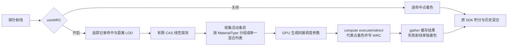
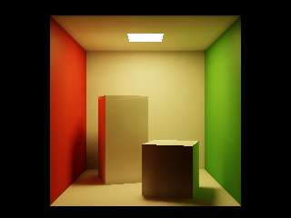
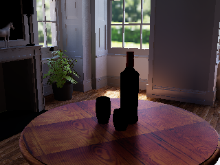
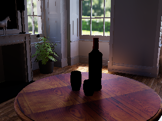
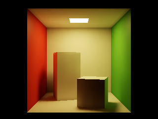
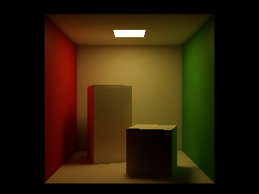
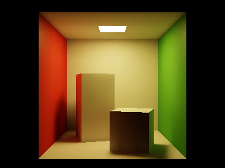

# RTXGI-DDGI 接入

`RTXGIDDGI` 是统一预览入口中的第四个独立渲染图，使用 NVIDIA [RTXGI-DDGI](https://github.com/NVIDIAGameWorks/RTXGI-DDGI) 的动态探针方案。Falcor 负责场景、三角形光线追踪、材质与灯光采样，DDGI 负责探针辐照度、距离矩、历史融合、重定位、分类和表面查询。传统 `TraditionalProbeGI` 仍用于静态烘焙对照。

构建通过 `cmake/rtxgi-ddgi.cmake` 下载固定版本 v1.3.7（提交 `c233266e95931231961f35c842c78e7c4bdc50cf`），并验证 SHA-256。SDK 解压到忽略的构建目录。此适配调用 SDK 原始着色器内核，由 Falcor 分配和绑定 GPU 资源，不编译 SDK 自带的原生 D3D12/Vulkan 库和测试程序。首次配置需联网；后续使用构建目录中的依赖缓存。

## 启动与切换

```powershell
.\Run-Falcor.cmd -Renderer DDGI -Scene Cornell
.\Run-Falcor.cmd -Renderer DDGI -Scene Room
```

后端为 D3D12。普通 `Run-Falcor.cmd` 也会加载 DDGI，可在 **Graphs → Active Graph → RTXGIDDGI** 切换。最终显示输出为 `Display.dst`。四个图共享场景和相机，只有当前图执行；切走 DDGI 会暂停更新，切回后保留已有历史，换场景则重建体积并重新收敛。

DDGI 无需手动 Bake，也不读取或写入静态探针缓存。移动相机不会重烘焙；光源和材质变化通过逐帧更新逐渐传播。历史权重较高时，明暗变化之后会有收敛延迟。场景几何发生较大变化后，可以重置历史以消除旧照明残留。

画面表面的直接照明默认使用 Falcor 已有的 `RTXDIPass` / RTXDI 1.3.0-falcor。`Visibility` 使用 `GBufferRT` 同时提供可见性、运动向量和降噪导向数据，RTXDI 通过 ReSTIR DI 做时空重采样；本图使用 `SpatiotemporalResampling` 和带可见性射线的 `RayTraced` 偏差校正，其余参数沿用现有模块默认值。

RTXDI 的 diffuse/specular illumination 已去除反射率，分别送入现有 NRD 3.1.0-falcor 的 `RelaxDiffuseSpecular`。`DirectDenoiser` 使用世界空间运动、线性深度、法线和粗糙度做时空降噪；`DirectModulate` 再乘回反射率，加回绕过降噪的自发光与环境背景。DDGI 向 `DirectModulate.output` 加上 `DDGI.indirect`，不会重复叠加自发光、背景，也不对探针间接光做屏幕降噪。`DirectLighting.color` 保留原始直接光，供调试对照。

环境光遵循 RTXGI-DDGI 1.3.7 官方 Test Harness 的分工：探针射线 miss 时写入天空辐射度；命中点计算局部灯光直接照明，再查询上一轮探针辐照度作为漫反射反馈，不再额外采样环境漫反射。Falcor 保留 HDR 环境贴图的方向、旋转与强度，替代官方示例的常量 `skyRadiance`。普通 DDGI 与 WRC 使用同一套 miss 和命中点着色逻辑；屏幕空间 RTXDI reservoir 不用于探针命中点。

`scripts/RTXGIDDGI.py` 为 RTXDIPass 设置 `excludeEnvDiffuse=true`：最终着色时仅剔除环境样本的漫反射贡献，保留环境镜面反射、自发光和背景。该选项默认关闭，其他 RTXDI 渲染图保持原行为。DDGI 的内置直接光回退路径同样只计算环境镜面反射。由此 `DDGI.indirect` 包含天空直接照到表面的漫反射以及多次反弹；关闭 **Enable DDGI** 也会移除这部分天空漫反射。发光面仍由 Falcor 的显式光源采样处理，SDK 原始算法内核保持不变。

```text
天空 → 探针 miss → 探针辐照度 → 表面漫反射
局部灯光 → 探针命中点着色 → 探针辐照度 → 表面漫反射
环境镜面反射、局部直接光、自发光和背景 → RTXDI/回退路径 → 合成
```

重置后的探针历史权重从 `updatedFrames / (updatedFrames + 1)` 逐渐提高，最大不超过设置的 `hysteresis`；前 32 帧关闭 DDGI SDK 的增亮限幅，之后恢复。这可加快冷启动收敛，同时保留稳定运行时的历史融合。ReSTIR DI 改善直接光采样，NRD 降低采样结果的噪声；本图没有 TAA，轮廓锯齿与降噪造成的细节损失仍可能存在。

在 `DirectDenoiser` 面板关闭 **Enabled**，可对照原始 RTXDI 直接光。关闭后跳过 NRD 计算，仅旁路信号；旁路输出为半精度，因此和 `DirectLighting.color` 会有小量舍入差异。重新启用会清空 NRD 历史，不清空 DDGI 探针。`maxIntensity` 默认设为 `10000`，限制的是去反射率后的信号亮度；极高亮信号仍可能被截断，需要按场景调整。

在 `DDGI` 面板关闭 **Use RTXDI direct light**，可对照每类光源单次采样的回退路径；切换不会清空探针历史。RTXDI 采样参数在 `DirectLighting` 面板调整。这个开关只改变合成所用的直接光，连接着的 RTXDI pass 仍会执行，因此不能用它直接测量回退路径的独立运行耗时。**Indirect only** 只显示 DDGI 提供的漫反射，其中包含天空漫反射；局部直接光、自发光、镜面反射及环境背景被隐藏。

Room 原有环境图含非有限 HDR 像素。DDGI 与 RTXDI 的 Falcor 适配层各维护一份 GPU 副本，将非有限或负的 HDR 通道置零后生成采样分布；各自的实际照明查询与背景查询使用相同的清理数据，并保留场景的环境强度和旋转。这避免个别异常 HDR 像素污染整个采样层级，不会修改场景或磁盘上的原始资产。

## 环境光对齐验证（2026-11-15）

环境光分工专项可用 `python tests/ddgi/run_environment_validation.py --root F:/` 重跑。测试生成单位亮度天空和灰色平面，验证天空进入 DDGI、RTXDI 不重复计算天空漫反射、保留镜面反射与背景，以及普通路径、WRC、回退路径和环境强度变化。输出位于 `build/ddgi-environment-validation/`。

2026-11-15 环境光对齐后，本机 D3D12 Release 验证通过：

| 验证 | 结果文件 | 结果 |
| --- | --- | --- |
| 环境光专项 | `build/ddgi-environment-validation/20261115-214745-8392ad5a/results.json` | 普通路径与 WRC 旁路最大误差为 0；天空强度缩至 1/4 后，DDGI 均值比例为 0.2499996；镜面反射、背景和通用 RTXDI 默认行为保留 |
| DDGI 基础回归 | `build/ddgi-validation/20261115-214209-3e279cfd/results.json` | Cornell/Room、30 张 DDGI HDR、动态光照、冻结恢复、重定位分类和尺寸切换通过 |
| RTXDI + NRD 回归 | `build/nrd-ddgi-validation/20261115-214600-92bbed88/results.json` | 560 张 HDR 检查通过；同帧合成最大误差约 3.82e-6 |

环境专项验证光照分工及动态响应；探针有限角分辨率、插值和体积边缘仍影响绝对照度，未据此宣称与路径追踪画质一致。下文 2026-10 的结果保留为修改前的历史记录。

## 初始参数与接口

| 参数 | 默认值 | 含义 |
| --- | --- | --- |
| `gridCounts` | `(8, 6, 8)` | 单个规则体积，共 384 个探针 |
| `raysPerProbe` | `256` | 每探针每次更新的射线数 |
| `hysteresis` | `0.97` | 历史权重；增大可降低噪声，减小可加快响应 |
| `normalBias`, `viewBias` | `0.05`, `0.05` | 查询点沿法线与视线的偏移，按最小探针间距的比例配置 |
| `autoBounds` | `true` | 场景包围盒每侧向外扩展该轴尺寸的 5%，生成探针体积 |
| `enableRelocation` | `true` | 使用几何距离信息调整探针位置 |
| `enableClassification` | `true` | 分类并跳过不适合更新的探针 |
| `updateEnabled` | `true` | 暂停或恢复逐帧更新，保留当前结果 |
| `showProbes` | `false` | 显示探针位置供布局检查 |
| `indirectOnly` | `false` | 只显示间接漫反射贡献 |
| `useRTXDI` | `true` | 使用已连接的 RTXDI 直接光；关闭或未连接输入时使用旧采样器 |
| `intensity` | `1.0` | 间接光照输出倍率 |

图定义位于 `scripts/RTXGIDDGI.py`，内部 pass 名为 `DDGI`，直接光 pass 名为 `DirectLighting`，降噪与重调制分别为 `DirectDenoiser`、`DirectModulate`。输入 `vbuffer` / `viewW` 来自 `GBufferRT`；可选输入 `directLighting` 接收已含自发光和背景的外部直接光。输出 `color` 为合成 HDR，`indirect` 为间接漫反射 HDR，均在色调映射之前。不连接 `directLighting` 的已有自定义图仍可独立运行。

自动体积覆盖场景包围盒的 110%，范围不随探针数量变化。这样场景表面处于 SDK 体积权重为 1 的区域，避免旧版内缩至 90% 后，探针加密使体积外淡出距离缩短、墙面和多次反弹反馈一起变暗。普通 DDGI 与 WRC 共用该范围；手动 `gridMin` / `gridMax` 保持用户指定值。

2026-10-27 在 Cornell 上关闭 WRC、只显示间接光，每探针 256 条射线，各更新 2048 次。`16×12×16 / 8×6×8` 的线性 HDR 平均亮度比由旧范围的 0.515 恢复到 0.970；左右墙面取样区域由约 0.23 恢复到 0.96～0.98。旧范围通过手动边界复现，其余设置相同。Cornell 两组密度和 Room 的新自动体积均包含完整场景包围盒，捕获的 HDR 与探针纹理均为有限值。

脚本可使用以下接口做原位控制，避免创建新 pass 丢失历史：

```python
p = m.activeGraph.getPass("DDGI")
p.set_properties({"updateEnabled": False})
p.set_properties({"updateEnabled": True})
p.set_properties({"useRTXDI": False})  # 原位对照旧直接光采样
p.set_properties({"useRTXDI": True})
p.reset()  # 在下一次执行时清空历史
print(p.updatedFrames, p.status)
print(p.stats)  # 按需 GPU 回读：数量、有限性和 irradianceMax

nrd = m.activeGraph.getPass("DirectDenoiser")
nrd.set_properties({"enabled": False})  # 对照未降噪 RTXDI
nrd.set_properties({"enabled": True})
nrd.set_properties({"resetHistory": True})  # 仅清空降噪历史
```

`stats` 提供 `updatedFrames`、`totalProbes`、`activeProbes`、`relocatedProbes`、`finite` 与 `irradianceMax`，并检查射线、距离矩与辐照度纹理中的有限性。材质、直接光、历史查询和最终射线结果的异常输入会计入对应诊断项，用于定位无效数据。统计回读会同步 GPU，适用于诊断，不应每帧调用做性能测量。

## 当前边界

- 本版接入 D3D12、单个自动包围体积；SDK 自身的 Vulkan 支持不代表此 Falcor 适配已支持 Vulkan。显式选择 DDGI + Vulkan 会被启动器拒绝。
- 支持三角形场景和 alpha test。其他几何类型需要补充相应追踪实现。
- 当前 RTXDI pass 使用针孔视线；默认图固定使用 Center 像素采样。此组合尚未接入薄透镜景深或像素抗锯齿。
- NRD 对低采样信号做时空重建，可能平滑细小阴影或在新显露表面短暂不稳定；它不增加真实光照路径，也不会补齐 DDGI 缺少的镜面间接光或透射。
- 主要近似漫反射间接光。镜面多次反射、正确透射和玻璃等效果不能与完整 PathTracer 等价。
- 自动范围方便初次接入，但不会替代场景布局设计。大场景、薄墙和复杂室内需要调整探针密度与查询偏移，重定位和距离矩不能保证消除所有漏光。
- 默认 384 × 256 条探针射线加上更新与屏幕查询有持续开销；本版没有跨体积调度、滚动体积或预算驱动更新。可选 WRC 实验用于共享探针命中点着色，见下文。
- 静态探针模式中的 “DDGI weights” 只是一种插值对照；它不等同于这里逐帧运行的 RTXGI-DDGI。

## 可复现验证

使用本机已有的 Python 和 `F:` 工程别名运行：

```powershell
python F:\tests\ddgi\run_validation.py
```

运行器以 `--device-type d3d12 --headless --deferred` 启动 Release Mogwai，基础分辨率为 320 × 240，所有日志、HDR 与临时静态缓存均写入新的 `build/ddgi-validation/<时间-随机标识>/`。不会读取或覆盖用户原有探针缓存。

`integration.py` 在一个进程中执行四图切换、Cornell/Room 场景切换、光源变化、冻结与恢复、重置、重定位与分类开关及 400 × 300 分辨率切换。Cornell 将发光材质强度降至四分之一，Room 将环境光强度降至四分之一，再恢复原值。PathTracer 以每帧 8 spp、64 帧累积提供明暗趋势对照。

`check_results.py` 检查线性 HDR 全部有限且有非零光照、冻结后的间接光一致、调暗及恢复方向正确，并记录 DDGI 与 PathTracer 的均值响应。它还检查真实 GPU 探针状态，不能仅以启用参数证明重定位和分类有效。这是功能验证，不是无偏画质或性能基准。

复用已完成的渲染结果：

```powershell
python F:\tests\ddgi\run_validation.py --reuse-renders F:\build\ddgi-validation\<运行目录>
```

实际执行结果以对应运行目录的 `integration.json` 和 `results.json` 为准；只有完成 GPU 渲染和图像检查后才能报告通过。

RTXDI 合成与直接光采样的专项验证：

```powershell
python F:\tests\ddgi\run_rtxdi_validation.py
```

输出在独立的 `build/rtxdi-ddgi-validation/<时间-随机标识>/`。这个原始采样专项会将直接光输入改接回 `DirectLighting.color`，独立验证 RTXDI。在 Cornell 和 Room 上检查同帧 `DDGI.color = DirectLighting.color + DDGI.indirect`、间接光开关、旧采样器切换、冻结历史、相机移动与返回、灯光调暗及恢复、401 × 301 奇数尺寸和无外部输入的兼容路径。每场景两种采样方式各捕获 32 张连续原始 HDR，报告时域方差；重采样带来的样本相关性也会降低该指标，不能将它视作对参考图的误差或等预算性能提升。GPU 计时单独捕获，不包含截图读回。

## 2026-10-21 本机验证结果

在 NVIDIA GeForce RTX 5080、D3D12、Release Mogwai 上完成验证。本机产物位于 `build/ddgi-validation/20261021-123151-a7ba66ea/`，运行器与图像检查均正常退出。

- 四个渲染图在同一进程中执行，共享场景和相机；切离 DDGI 不更新历史，切回继续。
- Cornell 和 Room 的场景切换、光源调暗和恢复、冻结及恢复、冻结状态下重置、探针调试显示以及分辨率切换均通过。
- 30 张 DDGI 线性 HDR 捕获全部有限且非零；射线、距离矩、探针数据和辐照度回读无非有限值。
- 两个场景在所有统计阶段的材质、直接光、历史查询与最终射线异常拒绝计数均为零。
- 禁用重定位与分类并重置后，两场景均为 384 个活动探针、0 个位移探针；启用后的实际状态见下表。

| 测量 | Cornell | Room |
| --- | --- | --- |
| 开启分类后活动探针 / 总数 | 292 / 384 | 277 / 384 |
| 开启重定位后有位移的探针 | 23 | 24 |
| 冻结期间间接 HDR 最大绝对差 | `1.49e-7` | `5.96e-8` |
| 光源降至四分之一、更新 96 帧后的间接均值 / 基线 | 0.3364 | 0.3630 |
| 同次光源变化的 PathTracer 全图均值 / 基线 | 0.2499 | 0.2624 |
| 恢复原光源并更新 96 帧后的间接均值 / 调暗结果 | 2.4604 | 1.9345 |

上述明暗比例证明动态响应方向正确，也显示 96 帧后历史尚未完全回到稳态，不能据此宣称与 PathTracer 等价。已人工查看两个场景的显示捕获：Cornell 可见间接照明和颜色传播；Room 的玻璃器皿、镜面和透射效果与 PathTracer 差别明显，直接光单帧采样也有可见噪声。这些是当前漫反射方案及未接最终图像降噪的边界，验证不覆盖任意场景画质。

## RTXDI 接入验证（2026-10-21）

Release 全量构建和 RTXDI 专项验证通过，使用 RTX 5080 / D3D12。专项产物在 `build/rtxdi-ddgi-validation/20261021-152747-96c9f71a/`。

原有四图切换、双场景、动态探针与重置回归也通过，产物在 `build/ddgi-validation/20261021-152859-20501611/`，其中 30 张 DDGI HDR 检查通过。

- 650 张线性 HDR 输出全部有限。同帧合成最大绝对误差 `3.81e-6`；未出现直接光、自发光或背景重复叠加。
- 开关 RTXDI / Indirect only 保持冻结的间接光不变，Cornell / Room 最大绝对差分别为 `2.09e-7` / `7.45e-8`。未连接外部直接光的兼容图也正常运行。
- 场景切换、相机移动及返回、401 × 301 尺寸切换、探针恢复更新均完成。相机测试检查有限性和合成，不构成无拖影证明。
- 将源光强降到四分之一，扣除自发光和背景后的表面直接光均值分别变为约 `0.246` / `0.258` 倍；恢复后回到约 `0.984` / `1.009` 倍。
- 在 320 × 240、冻结探针、每模式连续 32 帧的测试中，RTXDI / 旧采样的平均像素亮度时域方差比为 Cornell `0.742`、Room `0.0257`。这是原始信号的时域波动，包含样本相关性影响，不是参考图误差，也不是等成本比较。
- 同尺寸下 RTXDI 直接光 pass 的 GPU 中位时间约为 Cornell `0.094 ms`、Room `0.107 ms`；不含动态探针更新成本，不能外推为 720p 或完整实时 GI 帧率。

上述结果对应仅接入 ReSTIR DI 的历史版本；当时最终画面未接 NRD/TAA，单面光源半影等区域保留可见噪声。当前默认图已加入 NRD，验证结果另列如下。

## NRD 直接光降噪验证

```powershell
python F:\tests\ddgi\run_nrd_validation.py
```

此专项使用默认图，产物写入新的 `build/nrd-ddgi-validation/<时间-随机标识>/`。同帧捕获原始 RTXDI 和 NRD 重调制结果，检查合成关系、有限性、旁路舍入误差、冻结探针下开关降噪的一致性，以及场景、灯光、相机、分辨率和渲染图切换。连续帧的时域方差用于描述噪声波动，不代表无偏误差或无拖影证明。

NRD 适配在首次执行、重建、换场景、重新启用及重要光照变化时使用 SDK 的 `CLEAR_AND_RESTART`。普通相机运动继续重投影；可用只读 `resetHistoryCount` 检查实际重置次数。SDK 算法内核没有修改，修改的是 Falcor 的接线、信号打包边界和历史生命周期。

2026-10-21 在 RTX 5080 / D3D12 上完成 Release 构建与专项验证，产物为 `build/nrd-ddgi-validation/20261021-164903-9108bc87/`：

- 560 张线性 HDR 输出均有限；同帧合成最大绝对误差 `3.81e-6`。NRD 关闭后的重调制输出通过 `2e-4 + 0.002 × |reference|` 的半精度舍入检查。
- 两个场景在冻结探针时，切换 NRD、显式清历史和四图切换后的间接光最大差均为零。
- 相机平移与返回没有增加 NRD 重置次数；重新启用、光源调暗和恢复、401 × 301 分辨率切换都在下一执行帧重置。两场景的降噪后表面直接光均能跟随四分之一源光强变化，再恢复。
- 已查看 1280 × 720 的开关对照和移动相机首帧捕获，位于 `build/nrd-ddgi-preview/`。墙面、桌面和半影颗粒显著减少，细小高光会被平滑，玻璃透射仍不在此管线范围内。

下表来自 320 × 240、冻结探针、连续 32 帧同帧配对信号，已扣除绕过降噪的自发光与背景。时域方差降低不等于同等幅度的准确度提升；Room 均值下降也表明滤波存在能量与细节取舍。

| 测量 | Cornell | Room |
| --- | --- | --- |
| 降噪 / 原始的平均像素亮度时域方差 | `0.00106` | `0.00766` |
| 降噪 / 原始的表面直接光平均亮度 | `0.979` | `0.813` |
| NRD pass GPU 中位时间（不含读回） | `0.095 ms` | `0.114 ms` |

这些计时仅描述测试分辨率下的 NRD pass，不包含探针更新，也不能外推完整 720p 帧率。当前历史策略在灯光强度/属性连续动画时可能每帧重置，牺牲时间累积以避免陈旧光照；连续动态灯的质量仍需专项调优。

## WRC 开关与探针更新实验

多个探针的射线可能命中同一片表面，重复计算直接光、阴影和历史 irradiance。WRC 将命中点分到世界空间单元，每个单元选一个代表点计算出射漫反射 radiance，供其他命中点共享。当前版本已替换首版实现，加入按相机距离变化的单元尺寸、有限线性探测和按材质类型组织的活动条目列表。

在 DDGI 面板勾选 **Use world radiance cache**，或执行：

```python
p = m.activeGraph.getPass("DDGI")
p.set_properties({"useWRC": True})   # WRC 实验路径
p.set_properties({"useWRC": False})  # 原有 traceProbes 路径，默认值
```

切换及修改缓存设置会重置探针历史。直接光的 RTXDI、NRD 与最终合成沿用原管线，`Indirect only` 可单独观察间接光变化。严格对照需为每种模式新建图、重新加载场景，并更新相同帧数；仅调用 `reset()` 不会重置用于采样的全部帧序列。

**查看空间哈希格子：** 开启 WRC 后，勾选 **Show WRC cells**。线框来自最近一次探针更新的实际活动槽位；每个立方体的最小角为 `cell × cellWidth`，边长为 `cellWidth = Cell scale × 最小探针间距 × LOD`，使用场景世界单位。它显示占用单元，不绘制整片空间的空格子，也不是 DDGI probe 的排列网格。

**Cell LOD** 可筛选某一级并查看其边长；颜色依次为 1× 青、2× 绿、4× 黄、8× 橙、16× 粉、32× 紫、64× 蓝。默认隐藏物体背后的线框，**Cell X-ray** 可穿透显示，**Cell opacity** 调节透明度。先将 **Max LOD** 设为 1×，可观察统一尺寸；恢复距离 LOD 后移动相机可观察尺寸分级。关闭 **Update probes** 会冻结当前活动单元，方便移动相机检查。

线框只叠加到 `color`，不修改探针数据或 `indirect` 输出；开关线框和筛选 LOD 不重置探针历史。关闭 WRC 或开启 `wrcBypassSharing` 时不画线框。此调试绘制有额外 GPU 开销，性能计时应关闭。相同空间格子的不同材质/法线键可能重叠显示。



追踪阶段先保存完整几何命中。后续 compute 阶段用 CAS 占用哈希槽，在有限步数内线性探测，并将新占用的条目加入对应 `MaterialType` 的独立列表。GPU 按各列表长度生成调度参数，着色阶段通过 `executeIndirect()` 只处理活动条目，不再扫描整张表。每组以 64 个线程对齐。

`Group shading by material`（`wrcGroupByMaterial`）控制调度方式，默认开启。关闭后，所有新占用单元进入同一个混合列表，由一次 compute `executeIndirect()` 着色。两种模式使用同一个 `shadeWRC` 和 `wrcShadeHit`，完整键、空间去重、着色采样数及 gather 回退规则不变。切换只使 WRC 缓存和列表失效，保留 DDGI 探针历史；若探针已冻结，新的列表在恢复更新时生成。

代表点计算“直接漫反射 + albedo × 历史 irradiance / π”。compute 着色通过支持 alpha test 的 inline ray query 追踪阴影；gather 将结果写回各条探针射线后，才调用原 SDK 更新 irradiance volume。每条射线仍保留自己的命中距离，SDK 的可见性、重定位和分类继续使用独立几何信息。miss、自发光和固定射线的处理沿用原路径。

这套实现参考 Tiago Sousa 的 SIGGRAPH 2025 idTech 8 讲稿第 17–21 页，本地资料为 `烘焙GI调研/GI演讲资料/idTech8/SOUSA_SIGGRAPH_2025_Final.pdf`。Falcor 当前在同一队列按 `MaterialType` 分组调用同一个通用着色 shader，尚未复现 idTech 的异步专用 shader 调度、屏幕缓存与最终屏幕 gather。表满或耗尽探测预算时，当前射线回退到原逐射线估计器；这是保留 DDGI 射线贡献的 Falcor 适配，与讲稿中的满表丢弃策略不同。

| 参数 | 默认值 | 含义 |
| --- | --- | --- |
| `useWRC` | `False` | 原路径和实验路径切换 |
| `wrcGroupByMaterial` | `True` | 按材质类型分组调度；关闭时全部活动单元混合为一次 compute dispatch |
| `wrcCellScale` | `0.1` | 基础单元宽度 = 此值 × 最小探针间距，范围 0.01–2 |
| `wrcLodDistance` | `8.0` | 距离分级尺度，以最小探针间距为单位，范围 0.1–128；减小会更早使用大单元 |
| `wrcMaxLod` | `16` | 最大单元宽度倍数，支持 1–64 的二次幂；1 表示固定基础尺寸 |
| `wrcProbeLimit` | `16` | 每条射线最多线性探测的槽数，范围 1–64；失败后逐射线着色 |
| `wrcTableSize` | `65536` | 哈希槽数；支持 64–1048576 的二次幂 |
| `wrcMaxAge` | `0` | 允许复用的历史更新次数；0 表示每次重新着色，1–8 允许有限跨帧复用 |
| `wrcShadeSamples` | `1` | 每个代表点的直接光采样数，范围 1–8；失败回退仍用原来的 1 次采样 |
| `wrcBypassSharing` | `False` | 验证用：拆分执行阶段，但每条射线都使用原着色计算 |

命中点到相机的距离决定单元宽度倍数：将 `1 + 距离 / 分级尺度` 向下取最近的二次幂，再限制到 `wrcMaxLod`。例如默认尺度为 8 个探针间距，距离达到该尺度时单元宽度变为 2 倍，达到 3 倍尺度时变为 4 倍。基础尺寸随探针间距设置，未硬编码为 25 cm，以适应 Falcor 场景的单位和尺度。

完整键包含 LOD、世界单元、材质编号和量化的有向几何法线，并携带材质类型分组。键已去除实例和三角形编号，同材质、同朝向的相邻三角形可共享结果。LOD 本身属于键，因此相机移动跨过分级边界时不会把不同尺寸的单元当作同一条缓存。薄壁、单元内纹理、shading normal、遮挡和查询偏移仍由代表点近似，可能造成漏光或平滑细节；共享随机样本也会增加射线之间的相关性。

跨帧复用在前 32 次探针更新期间关闭，之后按真实着色时间计算年龄，读取不会延长有效期。几何、材质、光源、环境或查询 bias 改变会使缓存失效；单纯移动相机不主动清空缓存。修改 `normalBias` 或 `viewBias` 只清除 WRC，保留探针更新计数。历史多次反射本身逐帧变化，因此增大 `wrcMaxAge` 会让光照反馈变慢，默认只做同次更新内的空间共享。

资源首次开启时创建，关闭后保留以便切回。缓冲区占用取决于射线数、槽数和材质类型数，实际字节数由 `wrcAllocatedBytes` 提供。活动列表减少无效着色线程，但命中记录、CAS 探测、列表构建、同步和 gather 仍有成本；减少着色次数是否带来加速需结合分阶段 GPU 时间判断。

实现位于 `Source/RenderPasses/RTXGIDDGI/`：

| 文件 | 职责 |
| --- | --- |
| `RTXGIDDGI.rt.slang` | 原 DDGI 入口及共享材质、光照查询；新增编译期 `DDGI_INLINE_SHADOW` 分支，默认仍使用 `TraceRay` |
| `WorldRadianceCache.slang` | 缓存结构、完整键、哈希与代表点着色辅助函数 |
| `WorldRadianceCache.rt.slang` | `traceWRC` 几何追踪和命中记录 |
| `WorldRadianceCache.cs.slang` | `buildWRC`、`prepareWRC`、`shadeWRC`、`gatherWRC`；为 compute 启用 inline shadow 分支 |

原 `traceProbes` 路径仍可独立对照，NVIDIA DDGI SDK 的更新内核未修改。

`stats` 除已有命中、占用、着色、回退和复用计数外，还提供 `wrcProbeSteps`、`wrcProbeLimitFailures`、实际最大倍数 `wrcMaxLod`、`wrcLodRays` 与 `wrcCrossPrimitiveServedRays`。`wrcActiveEntries` 为活动条目总数，`wrcShaderGroups` 为当帧非空列表数（关闭分组时最多为 1），`wrcScheduledThreads` 为各列表向上对齐到 64 后的线程总数；`wrcMaterialTypes` 始终表示场景中的材质类型数，`wrcDispatches` 表示着色调度调用次数，包含线程数为零的列表。跨三角计数比较射线与本帧代表点的几何编号，数量取决于资产是否共用材质编号；跨帧复用时，它不追踪旧 radiance 最初来自哪一个三角形。

### 材质分组调度开关对照（2026-10-28）

`materials.pyscene` 含 11 种材质类型。这次比较只切换 `wrcGroupByMaterial`，保持 WRC 去重和着色公式不变。硬件为 RTX 5080，驱动 617.14，D3D12 Release；探针 8×6×8，每探针 256 条射线，输出 320×240，表大小 65,536，`wrcMaxAge=0`、`wrcShadeSamples=1`，测量时关闭单元显示。

两个独立进程分别按“开关关开”和“关开开关”运行，各进程只创建一次场景和渲染图。初始预热 128 帧，每个计时窗口前再运行 41 帧；窗口记录 192 帧，去掉前 5 条记录后取中位数，最后对每种模式的四个窗口中位数再次取中位数。计时期间持续更新探针，不截图、不读回统计。

| GPU 阶段 | 分组开启 | 分组关闭 | 关闭后的变化 |
| --- | ---: | ---: | ---: |
| WRC 着色 | 0.213952 ms | 0.024576 ms | −88.5%，约 8.71 倍速度 |
| 整个探针更新（含 SDK） | 0.317952 ms | 0.127872 ms | −59.8%，约 2.49 倍速度 |
| 几何追踪 | 0.028160 ms | 0.028032 ms | 基本持平 |
| 哈希与列表构建 | 0.004864 ms | 0.004736 ms | 基本持平 |
| gather | 0.005376 ms | 0.005376 ms | 持平 |
| SDK 探针更新 | 0.061824 ms | 0.061696 ms | 基本持平 |

两种模式各取 16 帧统计，平均有效命中数均为 8,105.19，平均着色条目数均为 4,121.875，回退数均为 0；实际非空列表和着色调度从 11 个降为 1 个。四个窗口的 WRC 着色中位数范围分别为 0.2104–0.2171 ms 和 0.0225–0.0264 ms。

当前每组仍调用同一个通用 shader，每帧约四千个条目拆成 11 批，在这个场景里明显更慢。结果说明本实现的分组收益不足以抵消额外调度和小批次执行成本；具体是提交、资源同步还是 GPU 利用率占主导，需进一步做底层 profiling 才能区分。它不代表专用材质 shader 或更大工作量下分组也一定无益。

两进程正常退出；计数守恒、12 张间接光 HDR 的有限值、运行时切换保留探针历史、冻结后切换与恢复、两种列表的单元显示、跨帧缓存失效与恢复复用均通过。代表点由并行 CAS 选出，切换顺序也会改变反馈历史，因此本测试没有要求逐像素完全一致。

复现：`python tests/ddgi/run_wrc_dispatch_benchmark.py`。原始窗口、统计和汇总见 [本次结果](../../build/wrc-dispatch-validation/20261028-000652-58cd115d/results.json)，源码及二进制摘要见 [运行记录](../../build/wrc-dispatch-validation/20261028-000652-58cd115d/run.json)。

### WRC 验证：六项测试

测试要回答三个问题：拆分流程有没有算错、共享光照损失了多少画质、减少着色是否真的更快。以下按六项展开，统一说明目的、做法和结果。

**统一条件：** RTX 5080，D3D12 Release，Cornell 和 Room 两个场景，320 × 240，384 个探针，每探针 256 条射线。每种对照模式新建渲染图、重新加载场景，使用相同的初始采样序列；保存首次更新和第 128–131 次更新的结果。默认 WRC 使用本节上方的参数，`wrcMaxAge=0`，每个代表点采样一次。

下文数值和截图来自 2026-10-26 的同一批测量 `20261026-151610-fb0bd9c8`。截图为原始 320 × 240 的完整合成画面，曝光设置相同；误差计算使用单独导出的线性 HDR 间接光，不使用截图的色调映射结果。

#### 1. 拆分管线是否正确

**目的：** 先排除追踪、着色、回填拆成多个阶段时引入的错误，再评价缓存共享带来的近似。

**做法：** 对比原 DDGI 与 `wrcBypassSharing=True`。后者走拆分流程，但每条射线仍独立着色。逐分量比较首次更新和四张稳定阶段间接光 HDR，同时检查探针总数、激活数、重定位数和更新次数是否一致。

令 A、B 为两条路径中同一个像素的同一个 RGB 分量。每个分量都必须满足：

$$
|A-B| \le 2\times10^{-6}+2\times10^{-5}\max(|A|,|B|)
$$

并报告所有被比较分量中的最大绝对差：

$$
E_{\max}=\max_{p,c,t}|A_t(p,c)-B_t(p,c)|
$$

**结果：通过。** Cornell 的最大差为 `5.96e-7`，Room 为 `2.68e-7`，探针状态一致。另检查了同帧“最终颜色 = 直接光 + 间接光”，最大绝对误差为 `7.39e-6`，通过合成检查的容差。

#### 2. 缓存共享后画面差多少

**目的：** 测量多个命中点共享代表点光照后，与原 DDGI 的差异。

**做法：** 原 DDGI 为参考 B，开启共享的 WRC 为 A。先分别平均第 128–131 次更新的四张间接光 HDR，再计算相对均方根误差和 RGB 均值比：

$$
\bar A(p,c)=\frac14\sum_{t=128}^{131}A_t(p,c),\qquad
\bar B(p,c)=\frac14\sum_{t=128}^{131}B_t(p,c)
$$

$$
\mathrm{rRMSE}=\sqrt{\frac{\sum_{p,c}(\bar A(p,c)-\bar B(p,c))^2}{\sum_{p,c}\bar B(p,c)^2}},\qquad
R_{\mathrm{mean}}=\frac{\sum_{p,c}\bar A(p,c)}{\sum_{p,c}\bar B(p,c)}
$$

p 遍历全部像素，c 遍历 RGB 三个分量。rRMSE 越小，越接近原 DDGI；均值比小于 1 表示整体 RGB 均值偏低。这两个指标衡量对原 DDGI 的偏离，参考图并非真实光照解。

| 默认 WRC | Cornell | Room |
| --- | ---: | ---: |
| 间接光 rRMSE | 0.70% | 16.16% |
| 间接光 RGB 均值比 | 0.9992 | 0.9445 |

| 场景 | 原 DDGI | 开启 WRC |
| --- | --- | --- |
| Cornell |  |  |
| Room |  |  |

图中为第 128 次更新的完整合成截图；可对照墙面、地面与桌面阴影处。直接光也包含在画面中，所以整体观感差异可能小于单独间接光的误差。表中数值则使用四帧平均结果。

**结果：Cornell 差异小，Room 偏差明显。** Room 在另一轮相同配置下曾测得约 9% 的 rRMSE，存在运行间波动。并行插入选出的代表点及其采样序列是待验证的原因。脚本的粗筛阈值为 rRMSE ≤ 40%、均值比在 0.7–1.3 之间；本轮通过粗筛，尚不能视为画质问题已解决。

#### 3. 省了多少计算，是否更快

**目的：** 分开衡量着色求值减少和实际 GPU 收益，判断节省是否抵消了哈希、列表构建与回填的成本。

**做法：** 对第 128–131 次更新的计数取平均。设 N 为有效着色射线数，C 为实际重新着色的缓存单元数，S 为每单元采样数，F 为回退到独立着色的射线数：

$$
E=C\times S+F,\qquad
R_{\mathrm{saved}}=\left(1-\frac{\operatorname{mean}(E)}{\operatorname{mean}(N)}\right)\times100\%
$$

E 对应 `wrcShadeEvaluations`，N 对应 `wrcValidRays`。分母只统计需要表面着色的有效射线，不是所有发射射线；回退计算也计入成本。

GPU 计时在截图之后独立进行：预热 8 帧，记录 64 帧，剔除最初 5 条记录后取中位数。期间保持探针更新，不执行截图和统计读回。探针更新阶段与完整 DDGI pass 分别计算：

$$
\Delta T=\left(\frac{T_{\mathrm{WRC}}}{T_{\mathrm{DDGI}}}-1\right)\times100\%
$$

正值表示变慢，负值表示耗时减少。

| 测量 | Cornell | Room |
| --- | ---: | ---: |
| 平均有效着色射线 N | 57,495 | 57,044.75 |
| 平均实际着色求值 E | 9,860 | 32,822 |
| 减少的着色求值 | **82.85%** | **42.46%** |
| 探针更新：原 DDGI → WRC | 0.1388 → 0.1367 ms | 0.1661 → 0.1924 ms |
| 探针更新耗时变化 | −1.48% | +15.79% |
| 完整 DDGI pass：原 DDGI → WRC | 0.1705 → 0.1695 ms | 0.2060 → 0.2340 ms |

**结果：计算次数减少，但尚无明确加速收益。** Cornell 耗时基本持平，Room 变慢约 16%。这组计时来自出现过连续编译内存增长的测试环境，暂作观察值；稳定性问题解决后仍需复测性能。

#### 4. 哈希碰撞与活动列表是否正确

**目的：** 确认缓存拥挤时没有漏掉射线，并且 GPU 只调度应处理的活动条目。

**做法：** 将哈希表缩为 64 槽，强制触发回退；另在固定 LOD、65,536 槽下比较最多探测 1 次和 16 次。每帧检查：

$$
N_{\mathrm{served}}+N_{\mathrm{fallback}}=N_{\mathrm{valid}},\qquad
N_{\mathrm{shaded}}+N_{\mathrm{reused}}=N_{\mathrm{occupied}}
$$

第一式确认每条有效射线都由缓存服务或单独着色；第二式确认每个占用单元都已重新着色或复用历史。活动条目数必须等于占用单元数。若非空材质组数为 G，调度线程数 T 还必须满足：

$$
N_{\mathrm{active}}\le T<N_{\mathrm{active}}+64G,\qquad T\bmod64=0
$$

这是每组线程数向上对齐到 64 的检查。额外用 Standard 与 PBRTDiffuse 两种材质类型验证分组。

**结果：通过。** 64 槽测试实际触发回退，计数守恒、HDR 有限；双材质测试生成了两组活动列表和间接调度。固定 LOD 下的平均回退射线数如下：

| 最多探测次数 | Cornell | Room |
| --- | ---: | ---: |
| 1 次 | 10,494.5 | 11,454.0 |
| 16 次 | 6.0 | 44.0 |

#### 5. 场景变化后缓存是否正确更新

**目的：** 检查旧光照能否失效、距离 LOD 能否随相机变化，以及冻结和恢复是否保持正确状态。

**做法与结果：** 生命周期测试先开启跨帧复用 `wrcMaxAge=2`，再依次执行下列操作。

| 操作 | 检查内容 | 结果 |
| --- | --- | --- |
| Cornell 面光源 / Room 环境光调到 25%，再恢复 | 变化后首帧清除旧缓存；各等待 96 次更新，检查间接光变暗与回升 | 通过 |
| 修改并恢复 normalBias、viewBias | 清除 WRC，探针更新计数继续推进 | 通过 |
| 相机拉远再返回 | LOD 变粗再变细，不主动清空全部缓存，输出保持有限 | 两场景均观察到 2× → 8× → 2× |
| 关闭再开启 WRC | 重置探针历史，首次更新计数为 1 | 通过 |
| 冻结 8 帧，切换到 401 × 301，再恢复尺寸 | 冻结时更新计数不变；恢复原尺寸后间接光保持一致 | 最大绝对差为 0 |
| 重新启用探针更新 | 渲染两帧后更新计数增加 2 | 通过 |

灯光响应使用全部线性 RGB 分量的平均值 μ，只要求方向和幅度达到以下检查条件：

$$
\frac{\mu_{\mathrm{dim}}}{\mu_{\mathrm{before}}}<0.8,\qquad
\frac{\mu_{\mathrm{restored}}}{\mu_{\mathrm{dim}}}>1.25
$$

Cornell 两个比值为 `0.339 / 2.452`，Room 为 `0.377 / 1.893`。DDGI 历史仍在收敛，因此本项没有要求光照均值立即精确缩放到 25%，也没有要求恢复后与原图完全相同。相机返程误差也只记录，不要求逐像素相等。

| Cornell：调暗前 | 光源调到 25%，更新 96 次后 | 光源恢复，更新 96 次后 |
| --- | --- | --- |
|  |  |  |

这组三张为跨帧复用测试中的完整合成截图，可看到光照变暗和恢复；上述比值仅由间接光 HDR 计算。

#### 6. 连续运行是否稳定

**目的：** 确认反复创建渲染图和编译 shader 时，测试能否完整跑完，并避免把中途失败的结果汇总成通过。

**做法：** 在同一进程连续运行两个场景的八种模式；再让每个“场景 × 模式”使用独立进程，共 16 个工作进程。工作进程全部完成后，才执行跨模式图像比较和场景汇总。

**结果：单进程压力测试未通过，隔离进程验证通过。** 单进程在第 15 个配置发生 `slang.dll` 访问违例，根因尚未解决。后续隔离批次 `20261026-170943-48be916b` 的 16 个进程均正常退出，336 张 HDR 全部有限，严格比较、状态检查和画质粗筛均通过；模拟工作进程崩溃也确认不会误报整场景通过。隔离运行限制了连续编译状态的累积，不能替代单进程稳定性修复。

复现以上测试，在仓库根目录执行：

```powershell
python tests/ddgi/run_wrc_validation.py
```

默认按模式隔离进程；加 `--single-process` 执行连续重建压力测试。检查公式见 [图像与统计检查器](../../tests/ddgi/check_wrc_results.py)，场景操作见 [测试脚本](../../tests/ddgi/wrc_integration.py)。数值和截图原始记录位于 [Cornell](../../build/wrc-ddgi-validation/20261026-151610-fb0bd9c8/cornell/results.json)、[Room](../../build/wrc-ddgi-validation/20261026-151610-fb0bd9c8/room/results.json)；双材质检查位于 [专项记录](../../build/wrc-active-smoke-left/smoke.json)。截图已原样复制到文档的 `images/wrc-validation/`，不依赖本地 build 目录显示。
